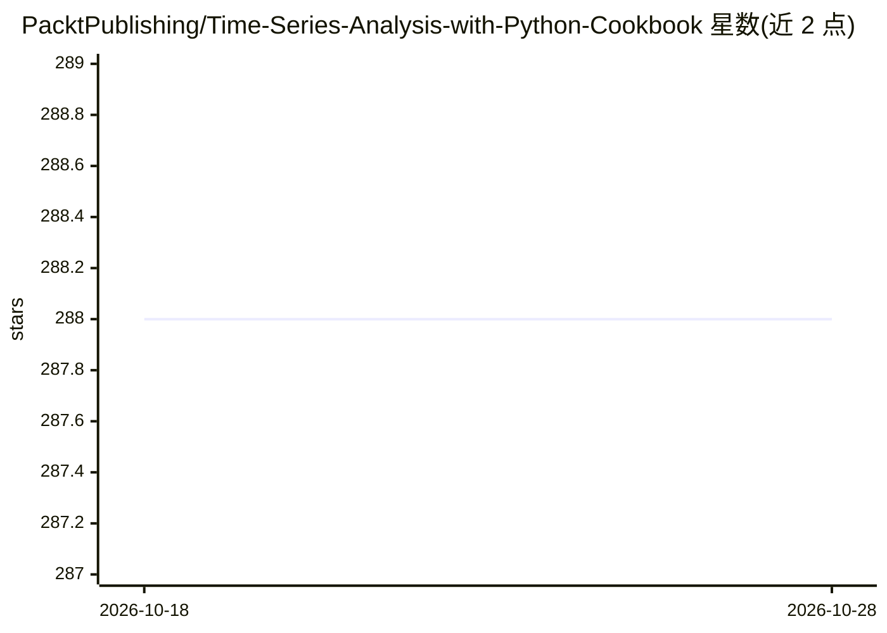

# PacktPublishing/Time-Series-Analysis-with-Python-Cookbook

⭐ 288 · Jupyter Notebook · 推送 2026-03-02 · [GitHub](https://github.com/PacktPublishing/Time-Series-Analysis-with-Python-Cookbook) · 组织维护

**时间序列分析与预测 Python 配方代码集（图书配套仓库）**

Packt 出版图书《Time Series Analysis with Python Cookbook》的配套代码仓库，以配方（recipe）形式覆盖时间序列数据摄取（含 InfluxDB 等专用时序库）、缺失值插补、异常检测（统计与无监督 ML）、经典统计预测（Holt-Winters/SARIMA/VAR）、状态空间模型与 UCM，以及 TensorFlow/PyTorch 的 ML/DL 预测，并含模型评估与优化配方。面向数据分析师、数据科学家、数据工程师等需要 Python 配方的读者；需具备 Python 基础。仓库为各章节提供 YAML 环境文件与 requirements.txt，部分章节提供 Colab 笔记本版本（进行中）。

## 筛选速览

| 维度 | 判定 | 备注 |
|---|---|---|
| AI 角色 | `ai-knowledge` | 知识聚合/清单类 |
| 许可风险 | `none` | — |
| 部署形态 | `None` |  |
| 模型依赖 | — | README 未给出锁定关系 |
| 硬件要求 | — | 无带数字的原话,不猜 |
| 安装摩擦 | `low` | 无编译、无系统依赖或容器化 |
| 成熟度 | — | 结构信号不足 |

## 能力要点

- 覆盖统计/ML/DL 三类预测与异常检测技术
- 涉及 pandas、Statsmodels、sktime、Darts、Prophet、PyTorch 等 18 个库
- 处理趋势、多重季节模式与非平稳数据的配方
- 各章节提供环境文件与依赖清单

## 适用场景

- 查找时间序列预测与异常检测的可运行 Python 配方
- 学习缺失值插补与时区/自定义工作日处理方法
- 对比经典统计模型与深度学习模型的实现方式

## 场景标签

`教程课程` · 领域:学习与行业

## 证据(README 行号)

> L30: # Time Series Analysis with Python Cookbook
> L41: - Explore forecasting and anomaly detection techniques using statistical, machine learning, and deep learning algor
> L66: This book is for data analysts, business analysts, data scientists, data engineers, or Python developers who want p

## 星数曲线

2026-10-18 288 → 2026-10-28 288（+0）

---
*卡片 v1 · prompt 1.4 · 生成 2026-10-22 · 置信度 high · 依据 README sha `fb3778f91c29` · [字段定义](../../DATASET.md)*
