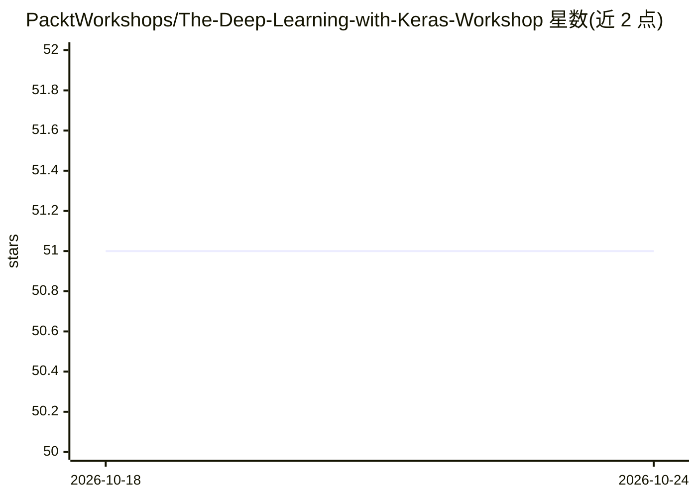

# PacktWorkshops/The-Deep-Learning-with-Keras-Workshop

⭐ 51 · Jupyter Notebook · MIT · 推送 2026-03-02 · [GitHub](https://github.com/PacktWorkshops/The-Deep-Learning-with-Keras-Workshop) · 组织维护

**Keras 深度学习课程的配套实践代码仓库**

Packt 出版的《The Deep Learning with Keras Workshop》一书配套仓库，提供从头到尾跟做课程所需的全部项目文件。内容覆盖神经网络基础、数据预处理、CNN 图像分类器构建、交叉验证评估调优、L1/L2 与 dropout 正则化等建模技术，并涉及逻辑回归、决策树、k-means 聚类等机器学习主题及 MRI 数据场景。运行需自行安装 Python 与 Anaconda（Windows/Mac/Linux）。

## 筛选速览

| 维度 | 判定 | 备注 |
|---|---|---|
| AI 角色 | `ai-knowledge` | 知识聚合/清单类 |
| 许可风险 | `permissive` | MIT |
| 部署形态 | `None` |  |
| 模型依赖 | — | README 未给出锁定关系 |
| 硬件要求 | — | 无带数字的原话,不猜 |
| 安装摩擦 | `low` | 无编译、无系统依赖或容器化 |
| 成熟度 | — | 结构信号不足 |

## 能力要点

- 书籍全部配套项目文件
- 覆盖 CNN 图像分类、交叉验证、正则化调优
- 包含 MRI 磁共振成像相关数据练习
- 支持 Windows/Mac/Linux 三平台 Python+Anaconda 环境

## 适用场景

- 跟书动手练习 Keras 深度学习建模
- 学习从数据预处理到模型评估调优的完整流程
- 参考 CNN 分类与正则化示例代码

## 场景标签

`教程课程` · 领域:学习与行业

## 证据(README 行号)

> L9: This is the repository for The Deep Learning with Keras Workshop, published by Packt. It contains all the supporting
> L19: The Deep Learning with Keras Workshop outlines a simple and straightforward way for you to understand deep learning

## 星数曲线

2026-10-18 51 → 2026-10-24 51（+0）

---
*卡片 v1 · prompt 1.4 · 生成 2026-10-24 · 置信度 high · 依据 README sha `d45e9951c15a` · [字段定义](../../DATASET.md)*
