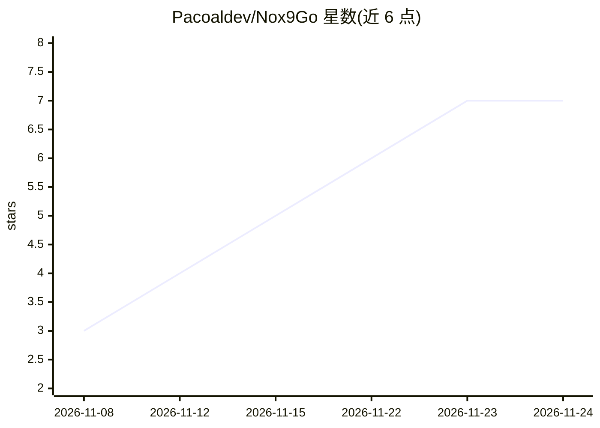

# Pacoaldev/Nox9Go

⭐ 7 · Go · MIT · 推送 2026-11-24 · [GitHub](https://github.com/Pacoaldev/Nox9Go) · 个人维护

**面向开发者的轻量 LLM 网关：统一接入多提供商与配额**

用 Go 编写的 AI 网关（9Router 的 fork，重写为独立二进制）：对外暴露 OpenAI/Anthropic 兼容端点，供 Claude Code、Cursor、Cline 等编码工具接入多个 AI 提供商，统一管理密钥、配额与模型。提供上下文压缩（RTK 等）、自动 failover、组合路由策略（fallback/round-robin/capacity/fusion）、内嵌 Svelte 面板、SSE 日志与用量指标；支持文本、图像、语音、embedding 与网页搜索路由。运行时去除了对 Node.js 的依赖，从源码用 Go 1.27 与 Bun 构建。

## 筛选速览

| 维度 | 判定 | 备注 |
|---|---|---|
| AI 角色 | `ai-ecosystem` | LLM/agent 周边工具 |
| 许可风险 | `permissive` | MIT |
| 部署形态 | `None` |  |
| 模型依赖 | local-ok | 支持本地模型 |
| 硬件要求 | — | 无带数字的原话,不猜 |
| 安装摩擦 | `low` | 无编译、无系统依赖或容器化 |
| 成熟度 | — | 结构信号不足 |

## 能力要点

- 单一 OpenAI/Anthropic 兼容端点接入多提供商，目录含 178 个注册提供商
- combo 路由策略：fallback、round-robin、capacity、fusion，以及同提供商账号轮换
- 上下文节省功能：RTK 压缩工具输出、Headroom 截断、注入防护
- 内嵌面板提供 SSE 实时日志、请求检查器与 token/成本指标

## 适用场景

- 为多个 CLI/IDE 编码工具配置统一的本地模型接入端点
- 在多个 AI 提供商与账号之间做配额与故障切换管理
- 本地追踪各模型 token 用量与估算成本

## 场景标签

`模型网关` · 领域:Agent 开发

## 证据(README 行号)

> L22: **NOX9GO** expone un único endpoint compatible con OpenAI y Anthropic para que tus herramientas de código puedan us
> L91: NOX9GO actúa como una capa intermedia entre tus herramientas de desarrollo y los proveedores de IA.
> L100: En lugar de apuntar cada herramienta a un proveedor distinto, todas apuntan a NOX9GO. El gateway decide a qué mode

## 星数曲线

2026-11-08 3 → 2026-11-24 7（+4）

---
*卡片 v1 · prompt 1.4 · 生成 2026-11-21 · 置信度 high · 依据 README sha `500e1973d75a` · [字段定义](../../DATASET.md)*
