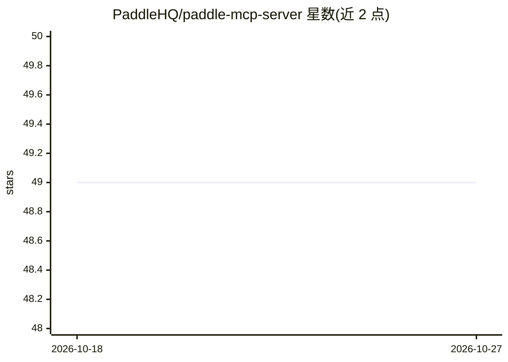

# PaddleHQ/paddle-mcp-server

⭐ 49 · TypeScript · Apache-2.0 · 推送 2026-09-27 · [GitHub](https://github.com/PaddleHQ/paddle-mcp-server) · [官网](https://developer.paddle.com/) · 组织维护

**Paddle 计费 API 的 MCP 服务器：让 AI 助手管理商品与订阅**

Paddle 官方提供的 Model Context Protocol（MCP）服务器，为 LLM 与 AI agent 提供与 Paddle Billing API 交互的工具集，覆盖商品/价格/折扣、客户、交易、订阅、通知、仿真、报表、客户端令牌等操作，接近 Paddle API 的全功能覆盖。通过 npx 运行或一键安装到 Cursor、VS Code、Claude Desktop、Windsurf 等 MCP 客户端；需要 Paddle API key，仅支持 Paddle Billing 而非 Paddle Classic。可用 --tools 或环境变量按 read-only/non-destructive/all 过滤加载的工具。

## 筛选速览

| 维度 | 判定 | 备注 |
|---|---|---|
| AI 角色 | `ai-ecosystem` | LLM/agent 周边工具 |
| 许可风险 | `permissive` | Apache-2.0 |
| 部署形态 | `library` | 以包/库形式分发 |
| 模型依赖 | — | README 未给出锁定关系 |
| 硬件要求 | — | 无带数字的原话,不猜 |
| 安装摩擦 | `low` | 无编译、无系统依赖或容器化 |
| 成熟度 | — | 结构信号不足 |

## 能力要点

- 覆盖商品、交易、订阅、报表等 20 余类 Paddle API 操作
- 支持三种安装配置方式（一键安装/命令行参数/环境变量）
- 工具可按 read-only / non-destructive / all 分级过滤
- 提供 MCP Inspector 调试支持

## 适用场景

- 在 Cursor/Claude Desktop 中通过对话管理 Paddle 商品目录与订阅
- 让 AI 助手创建交易、处理退款并生成财务报表
- 用只读模式让 AI 安全查询账单与客户数据

## 场景标签

 · 领域:支付/计费 API 工具

## 证据(README 行号)

> L5: This is a Model Context Protocol (MCP) server that provides LLMs and AI agents with tools for interacting with the P
> L17: The MCP server has near parity with the Paddle API, allowing AI assistants and agents to:

## 星数曲线

2026-10-18 49 → 2026-10-27 49（+0）

---
*卡片 v1 · prompt 1.4 · 生成 2026-10-24 · 置信度 high · 依据 README sha `318fb6185fb7` · [字段定义](../../DATASET.md)*
