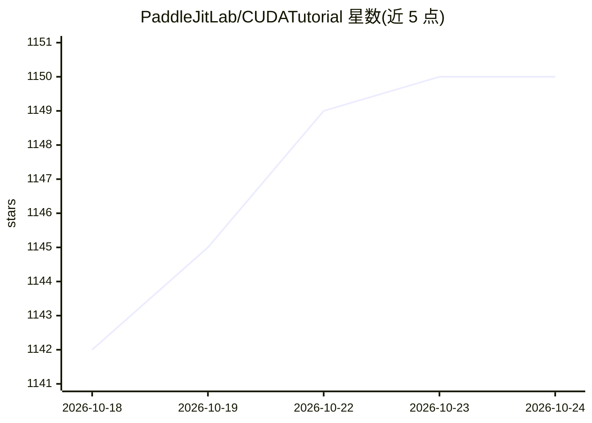

# PaddleJitLab/CUDATutorial

⭐ 1,151 · JavaScript · Apache-2.0 · 推送 2026-01-14 · [GitHub](https://github.com/PaddleJitLab/CUDATutorial) · 个人维护 · 中文 README

**CUDA 高性能编程与 LLM 推理技术的中文自学教程仓库**

个人学习笔记型教程仓库，按新手村、初阶、中阶、高阶四个梯度组织 CUDA 编程内容：从环境构建、手写 Kernel、线程模型，到 Matmul/Reduce/GEMM/卷积算子优化（含双缓冲、warp tiling、CUTLASS 策略）与多 GPU、CUDA 流等主题；另设 Triton 编程系列和 LLM 推理技术系列，覆盖 Flash Attention、连续批处理、Page Attention 及 vLLM 源码解读。提供网页版在线阅读地址。

## 筛选速览

| 维度 | 判定 | 备注 |
|---|---|---|
| AI 角色 | `ai-knowledge` | 知识聚合/清单类 |
| 许可风险 | `permissive` | Apache-2.0 |
| 部署形态 | `None` |  |
| 模型依赖 | — | README 未给出锁定关系 |
| 硬件要求 | — | 无带数字的原话,不猜 |
| 安装摩擦 | `medium` | 含编译或系统依赖之一 |
| 成熟度 | — | 结构信号不足 |

## 能力要点

- 四级学习路线覆盖 CUDA 入门到 GEMM/卷积算子优化
- Triton 编程系列（Softmax 算子实现等）
- LLM 推理技术系列含 Flash Attention/Page Attention 与 vLLM 源码解读
- 提供网页版在线阅读

## 适用场景

- 系统自学 CUDA 高性能编程并跟做算子优化实践
- 了解 Triton 编程范式与算子实现
- 阅读 vLLM 源码解读学习 LLM 推理架构

## 场景标签

`教程课程` · 领域:学习与行业

## 证据(README 行号)

> L3: 从零开始学习 CUDA 高性能编程，从入门到放弃，哦不！一起来边学习，边打笔记，日拱一卒！
> L56: ### LLM 推理技术 🤖

## 星数曲线

2026-10-18 1,142 → 2026-10-24 1,150（+8）

---
*卡片 v1 · prompt 1.4 · 生成 2026-10-21 · 置信度 high · 依据 README sha `3dadad942f45` · [字段定义](../../DATASET.md)*
