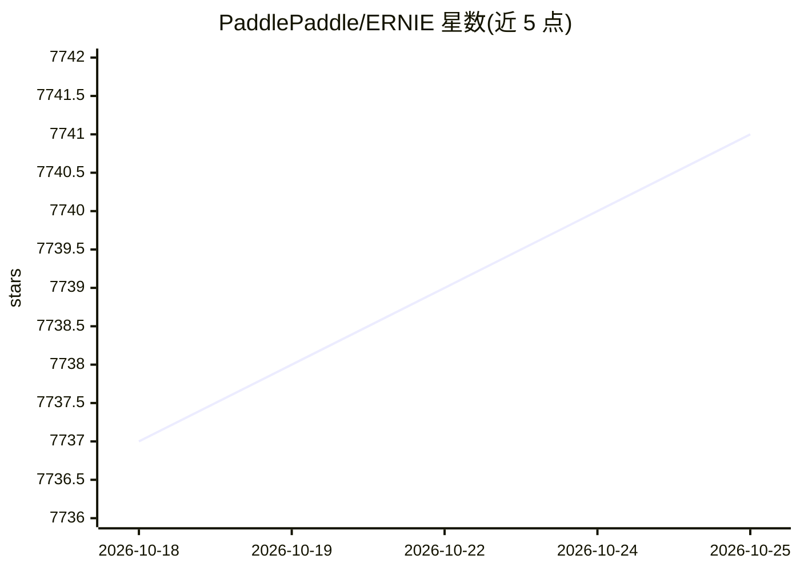

# PaddlePaddle/ERNIE

⭐ 7,742 · Python · Apache-2.0 · 推送 2026-07-24 · [GitHub](https://github.com/PaddlePaddle/ERNIE) · [官网](https://ernie.baidu.com) · 组织维护 · 中文 README

**百度 ERNIE 4.5 多模态大模型系列官方仓库与 ERNIEKit 训练工具套件**

官方仓库发布 ERNIE 4.5 系列 10 个模型（MoE 架构，最大 424B 总参数/47B 激活，含 0.3B dense 与 VL 视觉语言模型），权重与推理代码以 Apache 2.0 在 Hugging Face 和 AI Studio 发布。配套 ERNIEKit：基于 PaddlePaddle 的训练与压缩工具套件，支持 SFT/LoRA/DPO/QAT、WebUI、多机训练；推理部署由 FastDeploy 承担，提供 BF16 到 2-bit 多种量化方案，并支持多硬件平台（含 iluvatar GPU）。训练各模型的最低硬件要求另有文档。

## 筛选速览

| 维度 | 判定 | 备注 |
|---|---|---|
| AI 角色 | `ai-native` | 本体是模型或模型工具 |
| 许可风险 | `permissive` | Apache-2.0 |
| 部署形态 | `None` |  |
| 模型依赖 | — | README 未给出锁定关系 |
| 硬件要求 | — | 无带数字的原话,不猜 |
| 安装摩擦 | `low` | 无编译、无系统依赖或容器化 |
| 成熟度 | — | 结构信号不足 |

## 能力要点

- 10 个 ERNIE 4.5 模型（LLM/VLM/dense）以 Apache 2.0 开源，上下文 128K
- ERNIEKit 提供全参数 SFT、DPO、SFT-LoRA/DPO-LoRA、QAT 与 WebUI 训练界面
- FastDeploy 支持 BF16/W4A16C16/FP8/2-bit 等多档量化推理
- 多模态异构 MoE 架构，文本与视觉模态联合预训练

## 适用场景

- 下载并本地部署 ERNIE 4.5 系列开源模型做文本/多模态任务
- 用 ERNIEKit 对 ERNIE 模型做 SFT/LoRA/DPO 微调与量化训练
- 通过 WebUI 进行模型训练与对话测试

## 场景标签

`多模态` `微调` `模型量化` · 领域:感知与多模态

## 证据(README 行号)

> L49: We introduce ERNIE 4.5, a new family of large-scale multimodal models comprising 10 distinct variants. The model fa
> L143: **ERNIEKit** is an industrial-grade training and compression development toolkit for ERNIE models based on PaddleP
> L172: ### FastDeploy：High-performance Inference and Deployment Toolkit for LLMs and VLMs Based on PaddlePaddle

## 星数曲线

2026-10-18 7,737 → 2026-10-25 7,741（+4）

---
*卡片 v1 · prompt 1.4 · 生成 2026-10-20 · 置信度 high · 依据 README sha `296a6627068b` · [字段定义](../../DATASET.md)*
