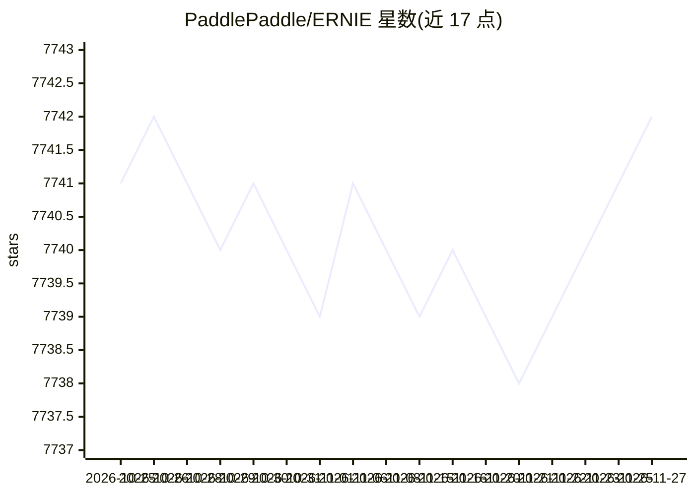

# PaddlePaddle/ERNIE

⭐ 7,742 · Python · Apache-2.0 · 推送 2026-11-26 · [GitHub](https://github.com/PaddlePaddle/ERNIE) · [官网](https://ernie.baidu.com) · 组织维护

**面向开发者的 ERNIE 4.5 模型族及其训练/推理工具包**

ERNIE 4.5 官方仓库：包含 10 个变体的大规模多模态模型族（MoE 架构最大 424B 总参/47B 激活，另有 0.3B 稠密模型），权重以 Apache 2.0 发布于 Hugging Face 与 AI Studio。基于 PaddlePaddle 提供 ERNIEKit 训练压缩工具包（预训练、SFT、LoRA、DPO、QAT、PTQ）与 FastDeploy 推理部署工具，支持量化方案（4-bit/2-bit）与 WebUI 训练界面。训练各模型的最低硬件要求在单独文档中给出，并提供多硬件兼容性。

## 筛选速览

| 维度 | 判定 | 备注 |
|---|---|---|
| AI 角色 | `ai-native` | 本体是模型或模型工具 |
| 许可风险 | `permissive` | Apache-2.0 |
| 部署形态 | `None` |  |
| 模型依赖 | — | README 未给出锁定关系 |
| 硬件要求 | — | 无带数字的原话,不猜 |
| 安装摩擦 | `low` | 无编译、无系统依赖或容器化 |
| 成熟度 | — | 结构信号不足 |

## 能力要点

- 10 个模型的 ERNIE 4.5 家族，Apache 2.0 开源权重
- ERNIEKit 支持预训练/SFT/LoRA/DPO/QAT 全流程
- BF16 到 2-bit 多档量化推理方案
- LLM 与 VL 模型分别支持 128K 上下文与文本/图像/视频输入

## 适用场景

- 对 ERNIE 4.5 模型做 SFT 或 LoRA 微调
- 部署量化后的 LLM/VLM 推理服务
- 用 WebUI 进行模型训练与对话调试

## 场景标签

`微调` `模型训练` `模型量化` `推理引擎` · 领域:训练与推理

## 证据(README 行号)

> L49: We introduce ERNIE 4.5, a new family of large-scale multimodal models comprising 10 distinct variants. The model fa
> L124: ERNIE 4.5 models are trained and deployed for inference using the PaddlePaddle) framework. The full workflow of tr
> L143: **ERNIEKit** is an industrial-grade training and compression development toolkit for ERNIE models based on PaddleP

## 星数曲线

2026-10-25 7,741 → 2026-11-27 7,742（+1）

---
*卡片 v1 · prompt 1.4 · 生成 2026-11-27 · 置信度 high · 依据 README sha `51238686686d` · [字段定义](../../DATASET.md)*
