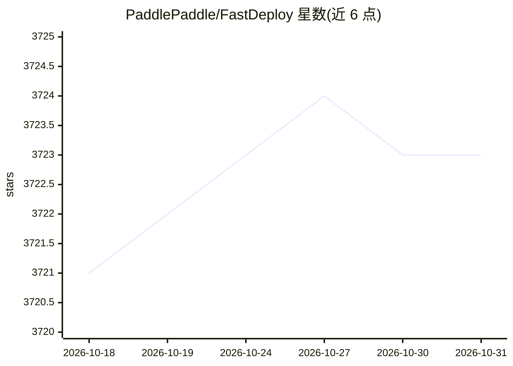

# PaddlePaddle/FastDeploy

⭐ 3,723 · Python · Apache-2.0 · 推送 2026-09-24 · [GitHub](https://github.com/PaddlePaddle/FastDeploy) · [官网](https://paddlepaddle.github.io/FastDeploy/) · 组织维护 · 中文 README

**基于飞桨的 LLM/VLM 高性能推理与部署工具包**

面向大语言模型与视觉语言模型的生产级推理部署套件：提供负载均衡式 PD 分离、统一 KV 缓存传输、OpenAI API 服务（兼容 vLLM 接口）、多档量化格式（W8A16 至 FP8）、推测解码与 MTP、分块预填充等能力。支持 Qwen3、DeepSeek V3、ERNIE-4.5 等模型在 NVIDIA GPU 及昆仑芯、海光、天数、燧原、沐曦、Gaudi 等多硬件上部署。要求 Linux 与 Python 3.10~3.12，安装细节见链接文档。

## 筛选速览

| 维度 | 判定 | 备注 |
|---|---|---|
| AI 角色 | `ai-ecosystem` | LLM/agent 周边工具 |
| 许可风险 | `permissive` | Apache-2.0 |
| 部署形态 | `None` |  |
| 模型依赖 | local-ok | 支持本地模型 |
| 硬件要求 | — | 无带数字的原话,不猜 |
| 安装摩擦 | `low` | 无编译、无系统依赖或容器化 |
| 成熟度 | — | 结构信号不足 |

## 能力要点

- 负载均衡式 PD 分离部署与动态实例角色切换
- OpenAI API 服务并兼容 vLLM 接口，单命令部署
- W8A16/W4A8/FP8 等全量化格式支持
- NVIDIA GPU 及昆仑芯/海光/天数/燧原/沐曦/Gaudi 多硬件支持

## 适用场景

- 在生产环境部署 LLM/VLM 推理服务
- 使用 PD 分离与量化降低部署资源成本
- 在国产硬件上运行主流开源大模型

## 场景标签

`推理引擎` `模型量化` · 领域:训练与推理

## 证据(README 行号)

> L26: **FastDeploy** 是基于飞桨（PaddlePaddle）的大语言模型（LLM）与视觉语言模型（VLM）推理部署工具包，提供**开箱即用的生产级部署方案**，核心技术特性包括：
> L30: - 🤝 **OpenAI API服务与vLLM兼容**：单命令部署，兼容vLLM接口

## 星数曲线

2026-10-18 3,721 → 2026-10-31 3,723（+2）

---
*卡片 v1 · prompt 1.4 · 生成 2026-10-20 · 置信度 high · 依据 README sha `5bdfb19461e0` · [字段定义](../../DATASET.md)*
