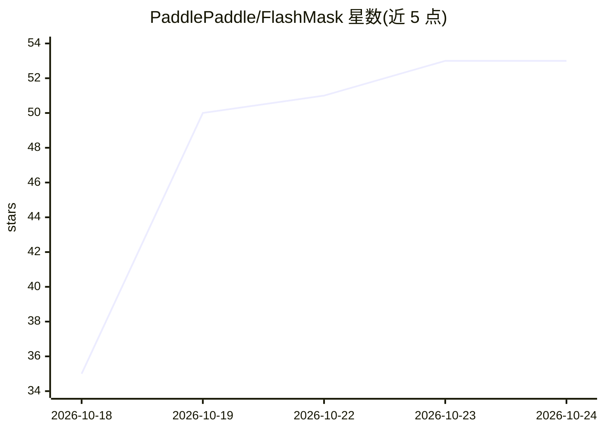

# PaddlePaddle/FlashMask

⭐ 53 · Python · BSD-3-Clause · 推送 2026-10-16 · [GitHub](https://github.com/PaddlePaddle/FlashMask) · 组织维护 · 中文 README

**面向稀疏掩码的高效注意力算子库，服务长上下文训练**

从 PaddlePaddle/flash-attention 演化出的独立注意力算子库：用列式稀疏掩码将 2D 稠密掩码编码为按列行索引区间，把掩码内存复杂度从 O(N²) 降到 O(N)，并跳过全掩码块计算。核心代码用 CuTe DSL 在运行时 JIT 编译，同时提供 PaddlePaddle 与 PyTorch 接口（共享同一套 kernel），覆盖 SM90/SM100 前向与反向。另含掩码感知的分布式注意力（CPB 负载均衡开源进行中、Overlap 通信重叠仅 SM100）及 SM100 大 head dim 支持。需 Hopper 或 Blackwell GPU。

## 筛选速览

| 维度 | 判定 | 备注 |
|---|---|---|
| AI 角色 | `ai-ecosystem` | LLM/agent 周边工具 |
| 许可风险 | `permissive` | BSD-3-Clause |
| 部署形态 | `library` | 以包/库形式分发 |
| 模型依赖 | — | README 未给出锁定关系 |
| 硬件要求 | — | 无带数字的原话,不猜 |
| 安装摩擦 | `medium` | 含编译或系统依赖之一 |
| 成熟度 | — | 结构信号不足 |

## 能力要点

- 列式稀疏掩码表示，掩码内存复杂度从 O(N²) 降至 O(N)
- PaddlePaddle 与 PyTorch 前端共享同一 CuTe DSL kernel 实现，运行时 JIT 编译
- mask-aware 分布式注意力：CPB 负载均衡 + 通信/计算重叠，兼容 DeepEP
- SM100 支持 512/512、576/512 大 head dim 及共享 KV

## 适用场景

- 长上下文大模型训练中加速灵活掩码注意力计算
- 需要 GQA/MQA 且 d≠dv（如 192/128）配置的掩码注意力
- 上下文并行场景下做掩码感知的负载均衡与通信重叠

## 场景标签

`模型训练` · 领域:训练与推理

## 证据(README 行号)

> L32: FlashMask is an **efficient attention kernel library** for flexible sparse masks. It uses a column-wise sparse mask
> L34: This repository evolved from PaddlePaddle/flash-attention and is now maintained as the standalone FlashMask reposit

## 星数曲线

2026-10-18 35 → 2026-10-24 53（+18）

---
*卡片 v1 · prompt 1.4 · 生成 2026-10-24 · 置信度 high · 依据 README sha `78aad7d9e3f9` · [字段定义](../../DATASET.md)*
