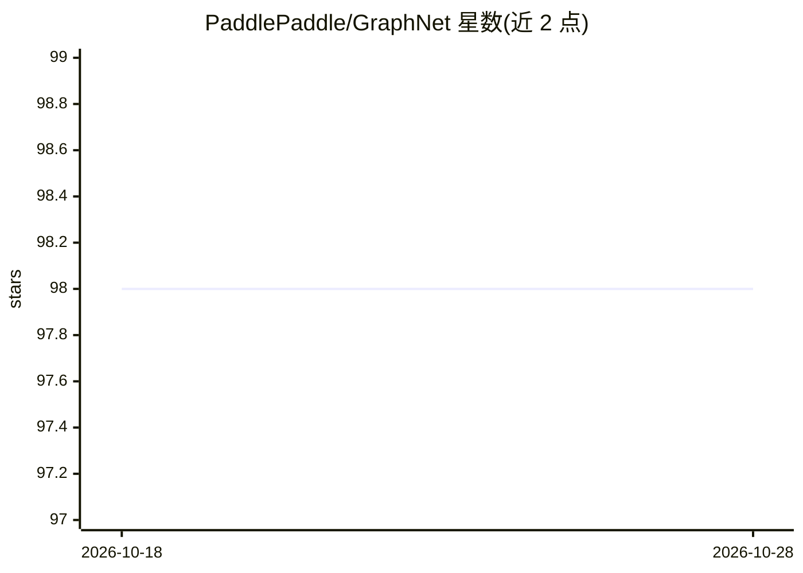

# PaddlePaddle/GraphNet

⭐ 98 · Python · MIT · 推送 2026-05-22 · [GitHub](https://github.com/PaddlePaddle/GraphNet) · 组织维护 · 中文 README

**面向张量编译器研究的大规模计算图基准数据集（2.7K+ 图）**

由 PaddlePaddle 团队发布的大规模深度学习计算图数据集，从多种任务和 ML 框架的主流模型中提取 2.7K+ 计算图，配标准化格式与元数据，用于张量编译器优化的公平比较与可复现评测。提供基准评测流程：以 eager 模式为基线，支持 CINN、TVM、Inductor、TensorRT、XLA、BladeDISC 等后端编译执行并计算加速比，配套提出 Speedup Score S(t) 与 Error-aware Speedup Score ES(t) 指标及可视化脚本，另有针对硬件的回归测试工作流。MIT 许可，社区含微信群。

## 筛选速览

| 维度 | 判定 | 备注 |
|---|---|---|
| AI 角色 | `ai-knowledge` | 知识聚合/清单类 |
| 许可风险 | `permissive` | MIT |
| 部署形态 | `None` |  |
| 模型依赖 | — | README 未给出锁定关系 |
| 硬件要求 | — | 无带数字的原话,不猜 |
| 安装摩擦 | `low` | 无编译、无系统依赖或容器化 |
| 成熟度 | — | 结构信号不足 |

## 能力要点

- 2.7K+ 计算图来自多种 ML 框架的主流模型
- 评测指标 Speedup Score S(t) 与 Error-aware Speedup Score ES(t)
- 基准流程支持 CINN/TVM/Inductor/TensorRT/XLA/BladeDISC 后端
- 两步式硬件回归测试工作流（对照 golden 参考验证正确性与性能）

## 适用场景

- 评估与比较不同张量编译器的优化效果
- 为编译器优化研究提供可复现的基准数据
- 做硬件相关的编译器正确性与性能回归测试

## 场景标签

`模型评测` · 领域:评测与运维

## 证据(README 行号)

> L6: **GraphNet** is a large-scale dataset of deep learning **computation graphs**, built as a standard benchmark for **t
> L73: **Vision**: GraphNet aims to lay the foundation for AI for Compiler by enabling **large-scale, systematic evaluatio

## 星数曲线

2026-10-18 98 → 2026-10-28 98（+0）

---
*卡片 v1 · prompt 1.4 · 生成 2026-10-23 · 置信度 high · 依据 README sha `2192b0aee8bf` · [字段定义](../../DATASET.md)*
