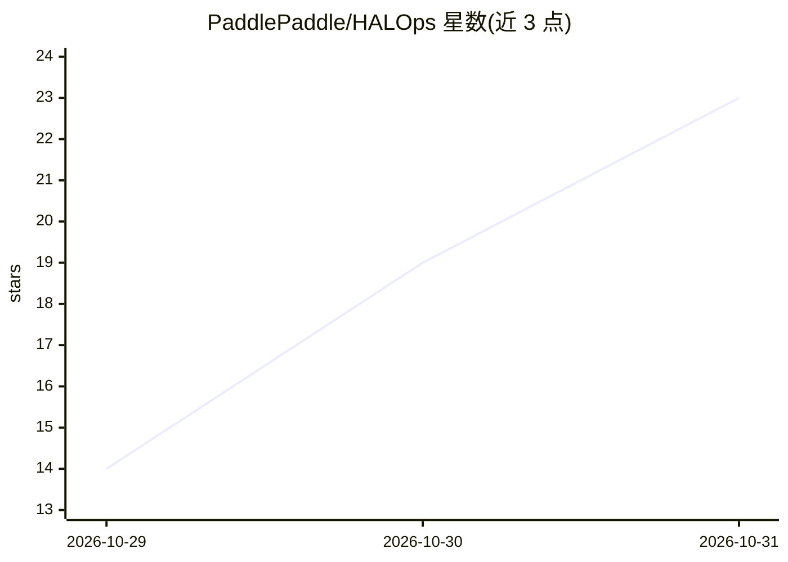

# PaddlePaddle/HALOps

⭐ 23 · Cuda · Apache-2.0 · 推送 2026-10-28 · [GitHub](https://github.com/PaddlePaddle/HALOps) · 组织维护 · 中文 README

**面向 NVIDIA Blackwell 的 LLM 推理高性能算子库**

由 ERNIE 团队开发的 LLM 推理算子库，基于 CUTLASS/CuTe 构建，直接使用 tcgen05、TMEM、TMA 等 SM100 硬件特性，采用 PDL、多流重叠、算子融合与 MegaKernel 消除 kernel 间空泡，覆盖 Attention、MoE、MLA 热点路径。提供 GQA attention（变长 prefill、paged-KV decode、BF16/FP8 KV cache、投机解码）、FP8/FP4 多精度 GEMM、MegaKernel 稀疏 MLA 等算子。要求 NVIDIA Blackwell SM100 GPU、CUDA 13.0+、Python 3.10+、PyTorch 2.13+；提供预编译 wheel 与源码构建两种安装方式，Apache 2.0 许可。

## 筛选速览

| 维度 | 判定 | 备注 |
|---|---|---|
| AI 角色 | `ai-ecosystem` | LLM/agent 周边工具 |
| 许可风险 | `permissive` | Apache-2.0 |
| 部署形态 | `library` | 以包/库形式分发 |
| 模型依赖 | — | README 未给出锁定关系 |
| 硬件要求 | — | 无带数字的原话,不猜 |
| 安装摩擦 | `medium` | 含编译或系统依赖之一 |
| 成熟度 | — | 结构信号不足 |

## 能力要点

- 针对 NVIDIA Blackwell (SM100) 设计，直接使用 tcgen05/TMEM/TMA
- GQA attention：变长 prefill、paged-KV decode、BF16/FP8 KV cache、投机解码
- FP8 (MXFP8) 与 FP4 (NVFP4/MXFP4) 块缩放 GEMM，覆盖 dense/batched/MoE grouped 负载
- MegaKernel 稀疏 MLA（HCA/SWA），消除 kernel 调度与中间显存往返

## 适用场景

- 在 Blackwell GPU 上加速 LLM 推理的 Attention/GEMM/MoE 计算路径
- 为自研推理框架提供 FP8/FP4 低精度 GEMM 与 paged-KV decode 算子
- 长上下文与小 batch decode 场景下提升算子级吞吐与延迟

## 场景标签

`推理引擎` · 领域:训练与推理

## 证据(README 行号)

> L13: HALOps (High-performance Accelerated LLM Operators) is a high-performance operator library for large language model
> L19: HALOps is designed from the ground up for NVIDIA Blackwell (SM100). Built on CUTLASS / CuTe, it uses tcgen05, TMEM 
> L21: - **GQA attention**: variable-length prefill and paged-KV decode across BF16 / FP8 KV cache, GQA and speculative de

## 星数曲线

2026-10-29 14 → 2026-10-31 23（+9）

---
*卡片 v1 · prompt 1.4 · 生成 2026-10-30 · 置信度 high · 依据 README sha `c4e48dec08e5` · [字段定义](../../DATASET.md)*
