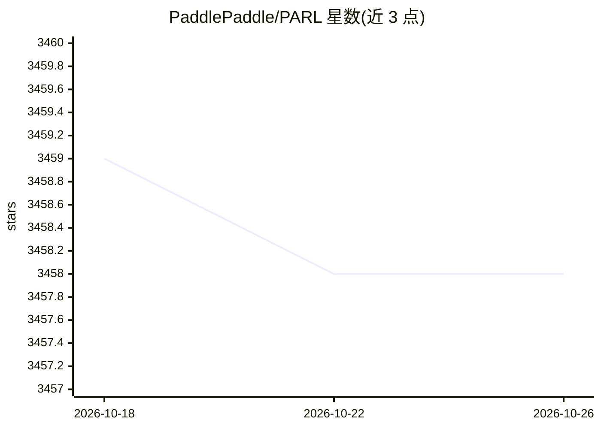

# PaddlePaddle/PARL

⭐ 3,458 · Python · Apache-2.0 · 推送 2026-09-30 · [GitHub](https://github.com/PaddlePaddle/PARL) · [官网](https://parl.readthedocs.io/) · 组织维护 · 中文 README

**分布式强化学习训练框架：并行化与算法复用**

基于 PaddlePaddle 生态的强化学习框架，提供 Model/Algorithm/Agent 三层抽象，内置 DQN、PPO、SAC、IMPALA 等算法实现与 NIPS 竞赛获奖方案。通过 @parl.remote_class 装饰器与 parl.connect 将单机代码转为并行版本，支持数千 CPU 与多 GPU 集群训练；paddlepaddle 为可选依赖，可仅使用并行化 API。2025 年更新含 GPU 端到端 Waymax 自动驾驶强化学习示例，并给出 xparl 集群安全配置要求。

## 筛选速览

| 维度 | 判定 | 备注 |
|---|---|---|
| AI 角色 | `ai-ecosystem` | LLM/agent 周边工具 |
| 许可风险 | `permissive` | Apache-2.0 |
| 部署形态 | `library` | 以包/库形式分发 |
| 模型依赖 | — | README 未给出锁定关系 |
| 硬件要求 | — | 无带数字的原话,不猜 |
| 安装摩擦 | `low` | 无编译、无系统依赖或容器化 |
| 成熟度 | — | 结构信号不足 |

## 能力要点

- Model/Algorithm/Agent 抽象，继承抽象类即可构建新算法
- @parl.remote_class 装饰器将代码转为并行版本，远程执行不耗本地算力
- 内置 DQN/PPO/SAC/IMPALA 等十余种算法示例与 NIPS 竞赛获奖方案
- xparl 集群要求 CURVE 加密与共享认证 token 的安全机制

## 适用场景

- 在新任务上复现或适配已有强化学习算法
- 利用 CPU 集群与多 GPU 做大规模并行训练
- 通过 Waymax 仿真做 GPU 端到端自动驾驶强化学习

## 场景标签

`强化学习` · 领域:训练与推理

## 证据(README 行号)

> L7: > PARL is a flexible and high-efficient reinforcement learning framework.
> L37: ## Parallelization

## 星数曲线

2026-10-18 3,459 → 2026-10-26 3,458（-1）

---
*卡片 v1 · prompt 1.4 · 生成 2026-10-20 · 置信度 high · 依据 README sha `182bcc1eb0d5` · [字段定义](../../DATASET.md)*
