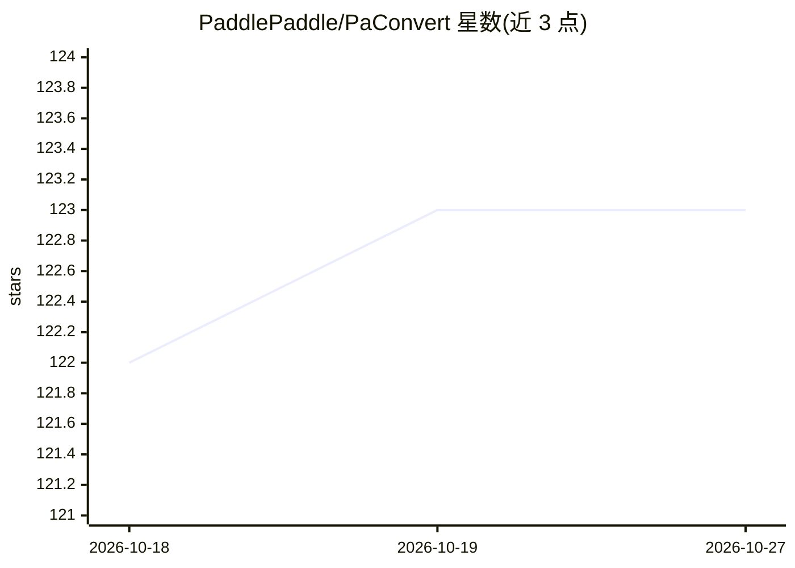

# PaddlePaddle/PaConvert

⭐ 123 · Python · Apache-2.0 · 推送 2026-08-17 · [GitHub](https://github.com/PaddlePaddle/PaConvert) · 组织维护 · 中文 README

**将 PyTorch 代码自动转换为飞桨 PaddlePaddle 代码的迁移工具**

Paddle 官方维护的代码转换工具：基于 PyTorch 与 Paddle 的 API 映射表，将 PyTorch 训练/推理代码自动转换为 PaddlePaddle 代码，支持 1600+ 个 torch API 与 200 个 torchvision API。通过 pip 安装后以命令行运行，指定输入/输出目录完成转换，尽量保持原代码风格与结构。转换后打印总 API 数、成功数与转换率；不支持的 API 以 >>>>>> 标记，需人工修改。官方给出在 100+ 个 PyTorch 代码库上平均转换率约 95% 的测试数据。

## 筛选速览

| 维度 | 判定 | 备注 |
|---|---|---|
| AI 角色 | `ai-ecosystem` | LLM/agent 周边工具 |
| 许可风险 | `permissive` | Apache-2.0 |
| 部署形态 | `library` | 以包/库形式分发 |
| 模型依赖 | — | README 未给出锁定关系 |
| 硬件要求 | — | 无带数字的原话,不猜 |
| 安装摩擦 | `low` | 无编译、无系统依赖或容器化 |
| 成熟度 | — | 结构信号不足 |

## 能力要点

- 支持 1600+ torch API 与 200 个 torchvision API 的自动转换
- 命令行运行，转换后输出转换率统计与不支持 API 清单
- 基于 PyTorch 最新 release 与 Paddle develop API 映射表
- Llama、Qwen 等大模型代码库官方给出 100% 转换率案例

## 适用场景

- 将已有 PyTorch 项目代码迁移到 PaddlePaddle 框架
- 评估代码库从 PyTorch 迁移到飞桨的工作量（转换率统计）
- 参考 Llama/Qwen 等大模型代码库的迁移案例

## 场景标签

`代码生成` · 领域:编码与开发

## 证据(README 行号)

> L6: - ✅ 本工具由 Paddle 官方维护与建设，高效自动化迁移 Pytorch 代码到 PaddlePaddle，欢迎使用
> L16: 本工具能自动将其它深度学习框架训练或推理的**代码**，转换为 PaddlePaddle 的**代码**，方便快速自动地 **模型代码迁移**。目前仅支持自动转换 Pytorch 代码，其它深度学习框架的支持后续新增中。

## 星数曲线

2026-10-18 122 → 2026-10-27 123（+1）

---
*卡片 v1 · prompt 1.4 · 生成 2026-10-23 · 置信度 high · 依据 README sha `297fcea7ae92` · [字段定义](../../DATASET.md)*
