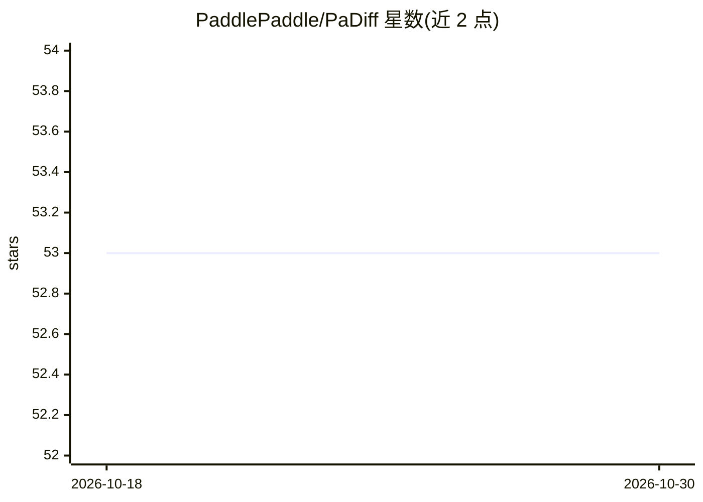

# PaddlePaddle/PaDiff

⭐ 53 · Python · 推送 2025-12-05 · [GitHub](https://github.com/PaddlePaddle/PaDiff) · 组织维护 · 中文 README

**Paddle 与 PyTorch 模型精度对齐工具，定位精度 diff 首现位置**

基于 PaddlePaddle 与 PyTorch 的模型精度对齐工具：传入 Paddle 和 Torch 模型，对齐训练中间结果与训练后模型权重，并提示精度 diff 第一次出现的位置。提供单行命令自动注入代码、生成临时脚本、运行监控并 dump 数据后自动对比；也支持手动用 PaDiffGuard 包裹模型调用、分别运行两个脚本后调用 compare_dumps 对比。当前暂不支持分布式，paddlepaddle 与 torch 同环境安装可能存在依赖冲突。通过源码 pip 安装。

## 筛选速览

| 维度 | 判定 | 备注 |
|---|---|---|
| AI 角色 | `ai-ecosystem` | LLM/agent 周边工具 |
| 许可风险 | `none` | — |
| 部署形态 | `library` | 以包/库形式分发 |
| 模型依赖 | — | README 未给出锁定关系 |
| 硬件要求 | — | 无带数字的原话,不猜 |
| 安装摩擦 | `low` | 无编译、无系统依赖或容器化 |
| 成熟度 | — | 结构信号不足 |

## 能力要点

- 单行命令自动完成代码注入、运行监控、数据 dump 与对比
- 提示精度 diff 第一次出现的位置
- PaDiffGuard 手动包裹方式支持两模型在两个环境中分别运行

## 适用场景

- 模型从 PyTorch 迁移到 Paddle 后排查精度不一致问题
- 定位训练过程中间结果（输出、梯度、权重）首次出现 diff 的位置

## 场景标签

 · 领域:深度学习/模型调试

## 证据(README 行号)

> L7: PaDiff 是基于 PaddlePaddle 与 PyTorch 的模型精度对齐工具。传入 Paddle 和 Torch 模型，对齐训练中间结果以及训练后的模型权重，并提示精度 diff 第一次出现的位置。
> L11: - 通过单行命令，自动完成 PaDiff 代码注入 --> 生成临时运行脚本 --> 自动运行 --> 监控运行过程并 dump 数据 --> 自动对比并返回结果。

## 星数曲线

2026-10-18 53 → 2026-10-30 53（+0）

---
*卡片 v1 · prompt 1.4 · 生成 2026-10-24 · 置信度 high · 依据 README sha `f36c35a1a7a1` · [字段定义](../../DATASET.md)*
