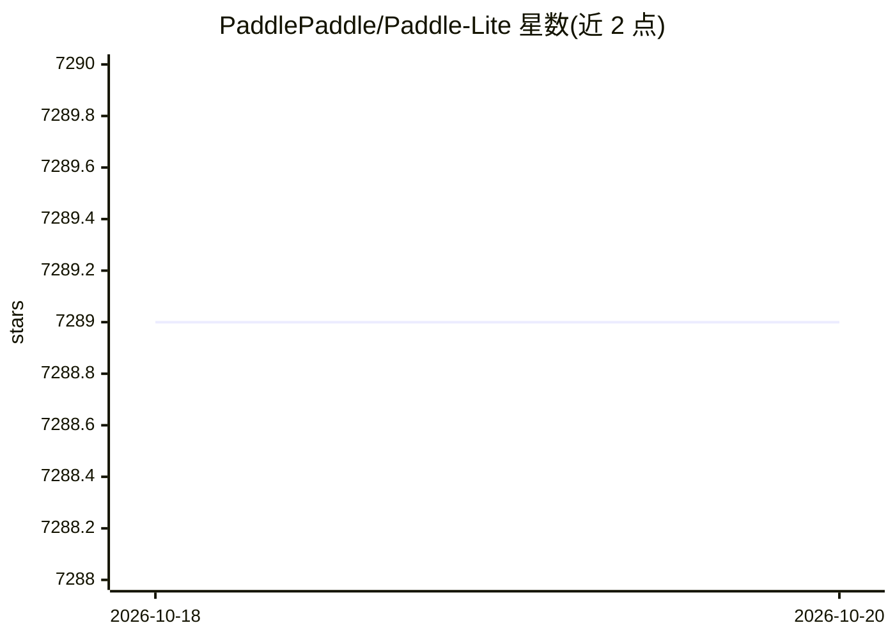

# PaddlePaddle/Paddle-Lite

⭐ 7,289 · C++ · Apache-2.0 · 推送 2026-04-27 · [GitHub](https://github.com/PaddlePaddle/Paddle-Lite) · [官网](https://www.paddlepaddle.org.cn/lite) · 组织维护 · 中文 README

**面向移动/嵌入式/边缘端多硬件的深度学习推理引擎**

飞桨（PaddlePaddle）体系的端侧推理框架，将 Paddle 格式模型部署到 Android、iOS、嵌入式 Linux、Windows、macOS 等平台，并提供 C++/Java/Python 三种 API。使用流程为：准备模型（非 Paddle 格式可用 X2Paddle 转换）、经 opt 工具做量化/子图融合/Kernel 优选等优化、下载预编译库或源码编译（建议 Docker 编译环境），再按示例集成。支持华为昇腾/麒麟、昆仑芯、高通 QNN、寒武纪、联发科 APU 等多种 NPU 后端。由百度团队维护，Apache-2.0 许可。

## 筛选速览

| 维度 | 判定 | 备注 |
|---|---|---|
| AI 角色 | `ai-ecosystem` | LLM/agent 周边工具 |
| 许可风险 | `permissive` | Apache-2.0 |
| 部署形态 | `None` |  |
| 模型依赖 | — | README 未给出锁定关系 |
| 硬件要求 | — | 无带数字的原话,不猜 |
| 安装摩擦 | `low` | 无编译、无系统依赖或容器化 |
| 成熟度 | — | 结构信号不足 |

## 能力要点

- 多平台支持：Android/iOS/嵌入式 Linux/Windows/macOS/Linux 主机
- opt 工具提供量化、子图融合、Kernel 优选等模型优化并检查算子支持情况
- 约 17 种硬件后端（NPU/GPU/CPU）含多硬件混合执行能力
- C++/Java/Python API 及各平台完整示例

## 适用场景

- 把训练好的深度学习模型部署到手机或嵌入式设备上运行推理
- 将 Caffe/TensorFlow/PyTorch 模型转换后在国产 NPU 硬件上加速推理
- 对端侧模型做量化压缩以降低体积和内存占用

## 场景标签

`推理引擎` `模型量化` · 领域:训练与推理

## 证据(README 行号)

> L7: Paddle Lite 是一个高性能、轻量级、灵活性强且易于扩展的深度学习推理框架，定位于支持包括移动端、嵌入式以及边缘端在内的多种硬件平台。
> L13: 使用 Paddle Lite，只需几个简单的步骤，就可以把模型部署到多种终端设备中，运行高性能的推理任务，使用流程如下所示：

## 星数曲线

2026-10-18 7,289 → 2026-10-20 7,289（+0）

---
*卡片 v1 · prompt 1.4 · 生成 2026-10-20 · 置信度 high · 依据 README sha `014c3b8a5b5f` · [字段定义](../../DATASET.md)*
