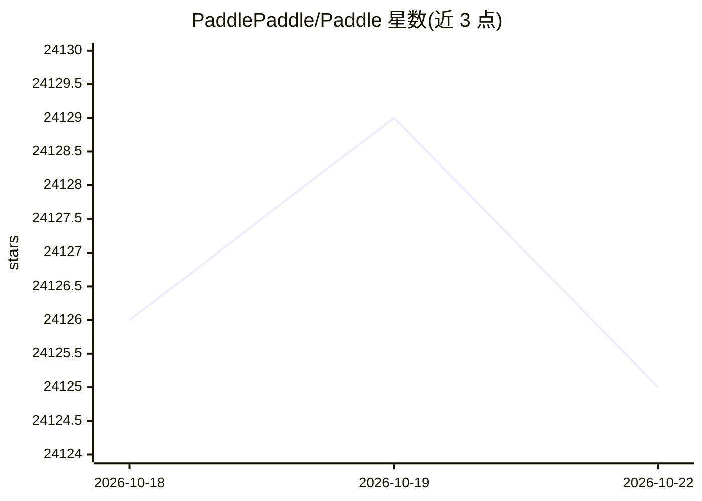

# PaddlePaddle/Paddle

⭐ 24,125 · C++ · Apache-2.0 · 推送 2026-10-21 · [GitHub](https://github.com/PaddlePaddle/Paddle) · [官网](http://www.paddlepaddle.org/) · 组织维护 · 中文 README

**深度学习框架，支持分布式训练与跨平台部署**

源自产业实践的深度学习平台，2016 年开源，覆盖核心框架、模型库、端到端开发套件与组件。3.x 版本支持动/静统一图与自动并行（单卡配置注解自动推导分布式策略）、大模型训练与推理一体化、高阶自动微分用于科学计算、神经网络编译器，以及多硬件芯片的统一适配方案。提供中英文文档与社区贡献渠道，采用 Apache-2.0 许可证。

## 筛选速览

| 维度 | 判定 | 备注 |
|---|---|---|
| AI 角色 | `ai-native` | 本体是模型或模型工具 |
| 许可风险 | `permissive` | Apache-2.0 |
| 部署形态 | `None` |  |
| 模型依赖 | — | README 未给出锁定关系 |
| 硬件要求 | — | 无带数字的原话,不猜 |
| 安装摩擦 | `low` | 无编译、无系统依赖或容器化 |
| 成熟度 | — | 结构信号不足 |

## 动量与使用信号

- 维护:`active` — 距上次 push 2.0 天,年发版 3,360 位贡献者
- 涨星:近 1 天 **+1**(自 20261016 起算)

## 能力要点

- 动/静统一图与自动并行分布式训练策略
- 大模型训练与推理同一框架、代码复用
- 高阶自动微分支持科学计算（微分方程求解）
- 多芯片异构适配，标准化接口抽象不同硬件栈

## 适用场景

- 工业场景的分布式深度学习模型训练
- 大模型的训练与推理一体化开发
- 数学、力学、材料、气象等科学计算探索
- 在多种国产/异构硬件芯片上部署训练

## 场景标签

`模型训练` `推理引擎` · 领域:训练与推理

## 证据(README 行号)

> L11: PaddlePaddle, as the first independent R&D deep learning platform in China, has been officially open-sourced to pro
> L24: ## **PaddlePaddle New Generation Framework 3.2**
> L28:  By requiring only minimal tensor partitioning annotations based on a single-card configuration, PaddlePaddle autom

## 星数曲线

2026-10-18 24,126 → 2026-10-22 24,125（-1）

---
*卡片 v1 · prompt 1.4 · 生成 2026-10-18 · 置信度 high · 依据 README sha `d9151da28199` · [字段定义](../../DATASET.md)*
