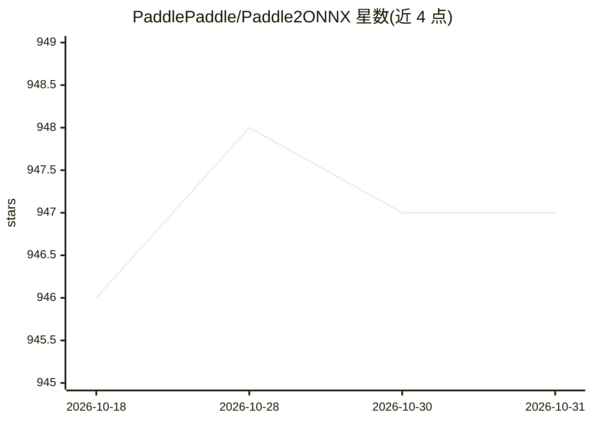

# PaddlePaddle/Paddle2ONNX

⭐ 947 · C++ · Apache-2.0 · 推送 2026-03-18 · [GitHub](https://github.com/PaddlePaddle/Paddle2ONNX) · 组织维护 · 中文 README

**将 PaddlePaddle 模型转换为 ONNX 格式的部署工具**

Paddle2ONNX 提供将 PaddlePaddle 部署模型（json 结构文件 + pdiparams 参数文件）转换为 ONNX 模型格式的能力，通过 ONNX 可将模型部署到 TensorRT/OpenVINO/MNN/TNN/NCNN 等推理引擎或硬件。以 pip 包与命令行方式使用，支持配置 OpSet 版本（7~19）、低版本自动升级、导出正确性检查与组合算子拆解等参数。依赖 PaddlePaddle 3.0 与 onnxruntime，面向需要跨引擎部署 Paddle 模型的开发者。

## 筛选速览

| 维度 | 判定 | 备注 |
|---|---|---|
| AI 角色 | `ai-ecosystem` | LLM/agent 周边工具 |
| 许可风险 | `permissive` | Apache-2.0 |
| 部署形态 | `library` | 以包/库形式分发 |
| 模型依赖 | — | README 未给出锁定关系 |
| 硬件要求 | — | 无带数字的原话,不猜 |
| 安装摩擦 | `low` | 无编译、无系统依赖或容器化 |
| 成熟度 | — | 结构信号不足 |

## 能力要点

- Paddle 部署模型转换为 ONNX 格式，面向 TensorRT/OpenVINO/MNN/TNN/NCNN 等推理引擎部署
- 支持 OpSet 7~19 版本指定与低版本无法转换时自动升级
- 可选 onnxchecker 检查导出模型正确性，可选 onnxoptimizer/polygraphy 优化工具
- 命令行 paddle2onnx 一条命令完成转换

## 适用场景

- 把训练好的 Paddle 模型转到 TensorRT/OpenVINO 等推理引擎上部署
- 将 PaddleOCR/PicoDet/PP-YOLOE 等模型导出为 ONNX 通用格式
- 转换前配置 OpSet 版本并校验导出模型的正确性

## 场景标签

 · 领域:深度学习部署/模型转换

## 证据(README 行号)

> L7: Paddle2ONNX 支持将 **PaddlePaddle** 模型格式转化到 **ONNX** 模型格式。通过 ONNX 可以完成将 Paddle 模型到多种推理引擎的部署，包括 TensorRT/OpenVINO/MNN/TN
> L41: 你可以通过使用命令行并通过以下命令将Paddle模型转换为ONNX模型

## 星数曲线

2026-10-18 946 → 2026-10-31 947（+1）

---
*卡片 v1 · prompt 1.4 · 生成 2026-10-21 · 置信度 high · 依据 README sha `a278ce233c2f` · [字段定义](../../DATASET.md)*
