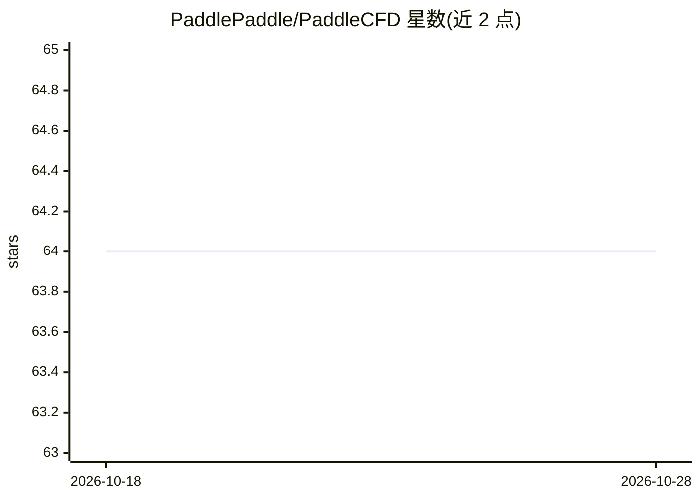

# PaddlePaddle/PaddleCFD

⭐ 64 · Python · Apache-2.0 · 推送 2026-10-12 · [GitHub](https://github.com/PaddlePaddle/PaddleCFD) · 组织维护 · 中文 README

**面向流体力学的深度学习代理建模工具包**

基于 PaddlePaddle 的流体力学深度学习工具包，定位代理建模、方程发现、形状优化与流动控制策略发现，当前主要支持代理建模，模型涵盖 FNO、Transformer、Diffusion Model、KAN 与 DeepONet。代码分为数据、模型、工具与自定义算子模块，提供示例脚本。安装方式包括 Docker 镜像、Conda 环境下源码安装或从 PyPI 安装 ppcfd；支持 NVIDIA GPU 运行，并给出在 MetaX 国产硬件上的运行与多卡并行效率说明。

## 筛选速览

| 维度 | 判定 | 备注 |
|---|---|---|
| AI 角色 | `ai-native` | 本体是模型或模型工具 |
| 许可风险 | `permissive` | Apache-2.0 |
| 部署形态 | `self-host` | docker 或自建部署 |
| 模型依赖 | — | README 未给出锁定关系 |
| 硬件要求 | — | 无带数字的原话,不猜 |
| 安装摩擦 | `low` | 无编译、无系统依赖或容器化 |
| 成熟度 | — | 结构信号不足 |

## 能力要点

- 支持 FNO/Transformer/Diffusion Model/KAN/DeepONet 等代理建模模型
- 提供 NVIDIA GPU 与 MetaX 两种运行路径
- Docker、源码、PyPI 三种安装方式
- 提供 paddlepaddle 自定义算子源码

## 适用场景

- 用神经算子等模型做流体力学代理建模
- 在 NVIDIA GPU 或 MetaX 硬件上运行流体仿真学习任务
- 多卡并行运行代理模型训练/推理

## 场景标签

 · 领域:流体力学/科学计算

## 证据(README 行号)

> L5: PaddleCFD is a deep learning toolkit for surrogate modeling, equation discovery, shape optimization and flow-control
> L85: PaddleCFD is provided under the Apache-2.0 license

## 星数曲线

2026-10-18 64 → 2026-10-28 64（+0）

---
*卡片 v1 · prompt 1.4 · 生成 2026-10-24 · 置信度 high · 依据 README sha `7c9b2d1b40c0` · [字段定义](../../DATASET.md)*
