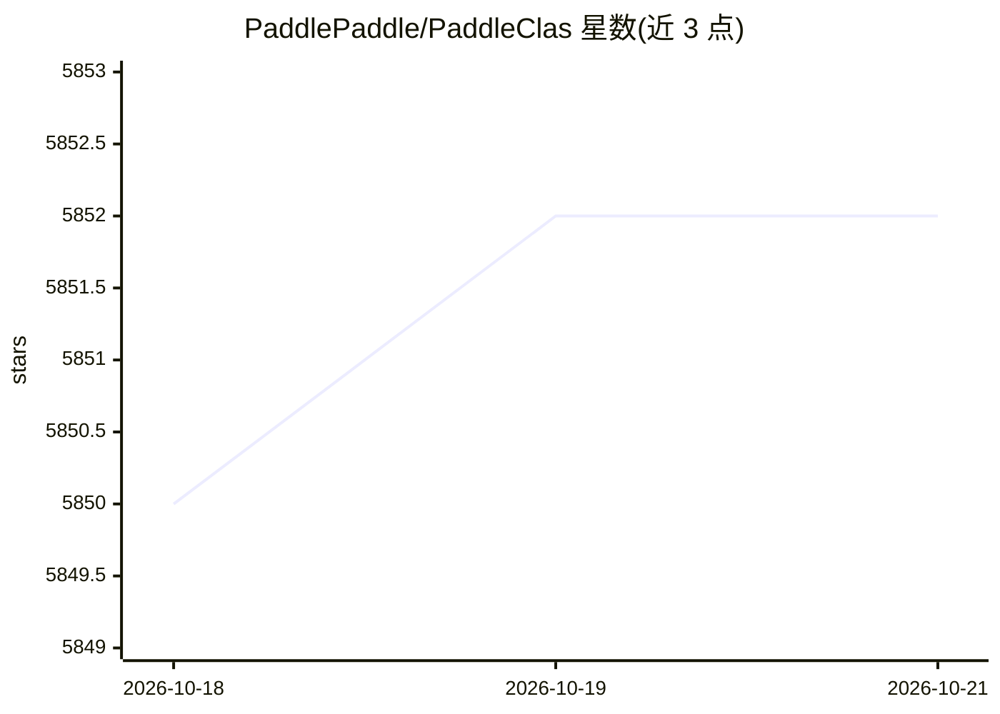

# PaddlePaddle/PaddleClas

⭐ 5,852 · Python · Apache-2.0 · 推送 2026-10-13 · [GitHub](https://github.com/PaddlePaddle/PaddleClas) · 组织维护 · 中文 README

**飞桨图像分类与识别工具集，面向工业落地**

基于 PaddlePaddle 的图像识别与图像分类任务工具集，面向工业界与学术界使用者。提供 PULC 超轻量图像分类方案（人、车、OCR 等九类任务）、PP-ShiTuV2 轻量图像识别系统（主体检测+特征学习+向量检索三模块）、PP-HGNet/PP-LCNet 等骨干网络与 SSLD 半监督知识蒸馏方案。支持 Python/C++ 预测引擎推理、服务化部署、端侧部署与 Paddle2ONNX 模型转化，覆盖商品识别、垃圾分类等 20+ 识别场景，提供 Android Demo。采用 Apache 2.0 许可。

## 筛选速览

| 维度 | 判定 | 备注 |
|---|---|---|
| AI 角色 | `ai-native` | 本体是模型或模型工具 |
| 许可风险 | `permissive` | Apache-2.0 |
| 部署形态 | `None` |  |
| 模型依赖 | — | README 未给出锁定关系 |
| 硬件要求 | — | 无带数字的原话,不猜 |
| 安装摩擦 | `low` | 无编译、无系统依赖或容器化 |
| 成熟度 | — | 结构信号不足 |

## 能力要点

- PP-ShiTuV2 识别系统：主体检测+特征学习+向量检索三模块
- PULC 超轻量分类方案，CPU 推理 3ms，覆盖九大常见任务
- 98 个核心模型可一键调用，整合为 6 条模型产线
- 支持 GPU、昆仑芯、昇腾、寒武纪、海光等硬件无缝切换

## 适用场景

- 训练和部署商品识别、车辆识别等图像识别应用
- 用轻量分类模型做人员出入、安全帽佩戴等实用分类任务
- 在多种国产及主流硬件上进行模型开发与部署

## 场景标签

`目标检测` · 领域:感知与多模态

## 证据(README 行号)

> L7: 飞桨图像识别套件PaddleClas是飞桨为工业界和学术界所准备的一个图像识别和图像分类任务的工具集，助力使用者训练出更好的视觉模型和应用落地。
> L130: PP-ShiTuV2是一个实用的轻量级通用图像识别系统，主要由主体检测、特征学习和向量检索三个模块组成。该系统从骨干网络选择和调整、损失函数的选择、数据增强、学习率变换策略、正则化参数选择、预训练模型使用以及模型裁剪量化多个方面
> L146: PULC融合了骨干网络、数据增广、蒸馏等多种前沿算法，可以自动训练得到轻量且高精度的图像分类模型。

## 星数曲线

2026-10-18 5,850 → 2026-10-21 5,852（+2）

---
*卡片 v1 · prompt 1.4 · 生成 2026-10-21 · 置信度 high · 依据 README sha `2d3902a82eae` · [字段定义](../../DATASET.md)*
