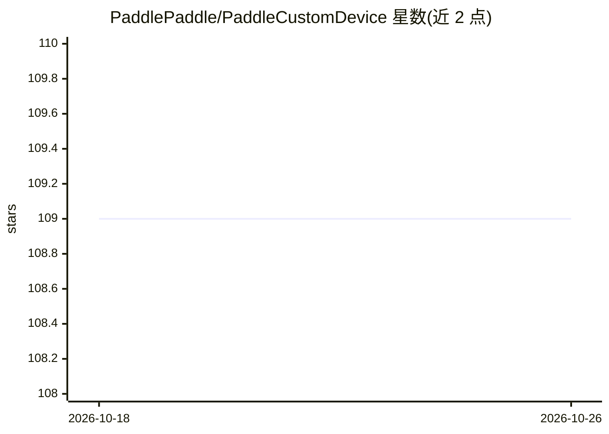

# PaddlePaddle/PaddleCustomDevice

⭐ 109 · Python · Apache-2.0 · 推送 2026-09-20 · [GitHub](https://github.com/PaddlePaddle/PaddleCustomDevice) · 组织维护 · 中文 README

**飞桨框架的自定义硬件后端接入实现集合**

PaddlePaddle 官方的自定义硬件接入实现仓库：按 Custom Device 接入方案，为飞桨深度学习框架提供非默认硬件后端的插件式实现，收录昇腾 NPU、寒武纪 MLU、英特尔 GPU、苹果 MPS、壁仞 GPU、燧原 GCU、太初 SDAA、沐曦 METAX、天数 ILUVATAR 等九种硬件后端。面向需要将飞桨模型部署到上述国产及第三方加速硬件的开发者；开发指南参考新硬件接入示例，示例代码位于 CustomCPU。以 Apache-2.0 许可证发布。

## 筛选速览

| 维度 | 判定 | 备注 |
|---|---|---|
| AI 角色 | `ai-ecosystem` | LLM/agent 周边工具 |
| 许可风险 | `permissive` | Apache-2.0 |
| 部署形态 | `None` |  |
| 模型依赖 | — | README 未给出锁定关系 |
| 硬件要求 | — | 无带数字的原话,不猜 |
| 安装摩擦 | `low` | 无编译、无系统依赖或容器化 |
| 成熟度 | — | 结构信号不足 |

## 能力要点

- 覆盖昇腾 NPU、寒武纪 MLU、英特尔 GPU、苹果 MPS 等 9 种硬件后端
- 基于 Custom Device 接入方案的插件式实现
- 提供 CustomCPU 示例代码作为新硬件接入参考

## 适用场景

- 把飞桨训练/推理任务跑在昇腾、寒武纪等国产加速硬件上
- 硬件厂商参考 Custom CPU 示例为飞桨适配新后端
- 查询飞桨已支持的第三方硬件后端列表

## 场景标签

`推理引擎` `模型训练` · 领域:训练与推理

## 证据(README 行号)

> L9: 『飞桨』自定义硬件接入实现。
> L17: 飞桨自定义硬件接入支持如下硬件后端：

## 星数曲线

2026-10-18 109 → 2026-10-26 109（+0）

---
*卡片 v1 · prompt 1.4 · 生成 2026-10-23 · 置信度 high · 依据 README sha `a3c95694ace4` · [字段定义](../../DATASET.md)*
