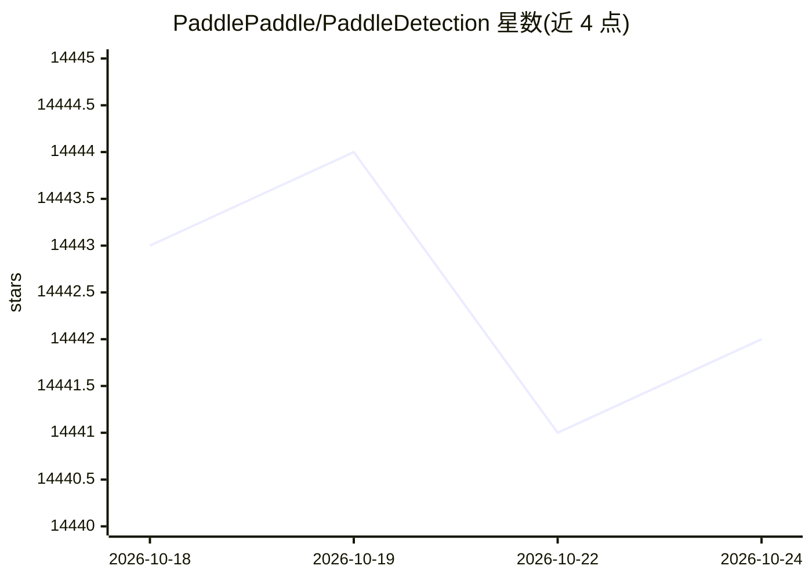

# PaddlePaddle/PaddleDetection

⭐ 14,444 · Python · Apache-2.0 · 推送 2026-05-28 · [GitHub](https://github.com/PaddlePaddle/PaddleDetection) · 组织维护 · 中文 README

**给开发者的目标检测端到端开发套件**

基于 PaddlePaddle 框架的目标检测开发套件，覆盖 2D/3D 目标检测、实例分割、多目标跟踪、关键点检测、人脸检测与半监督学习等方向。将模型解耦为 backbone、neck、loss、数据增强等可组合模块，提供 PP-YOLOE+、PP-PicoDet、PP-TinyPose、PP-HumanV2、PP-Vehicle 等产业特色模型与预训练权重，并整理农业、工业、交通等领域的应用范例。部署路径包括 Paddle Inference、Paddle Lite、Paddle Serving 及 ONNX 导出。安装说明需另行参考安装文档。

## 筛选速览

| 维度 | 判定 | 备注 |
|---|---|---|
| AI 角色 | `ai-ecosystem` | LLM/agent 周边工具 |
| 许可风险 | `permissive` | Apache-2.0 |
| 部署形态 | `None` |  |
| 模型依赖 | — | README 未给出锁定关系 |
| 硬件要求 | — | 无带数字的原话,不猜 |
| 安装摩擦 | `low` | 无编译、无系统依赖或容器化 |
| 成熟度 | — | 结构信号不足 |

## 动量与使用信号

- 维护:`maintenance` — 距上次 push 143.1 天,年发版 1,176 位贡献者
- 涨星:近 1 天 **-2**(自 20261016 起算)
- 平台:LINUX · 协议:—

## 能力要点

- 模型库覆盖 2D/3D 检测、实例分割、多目标跟踪、关键点检测等方向
- 模块化设计：backbone/neck/loss/数据增强组件可自定义组合
- 提供 Paddle Inference/Paddle Lite/Paddle Serving 部署与 ONNX 导出
- PP 系列产业模型附带预训练模型与产业应用示例代码

## 适用场景

- 训练和部署自定义目标检测模型
- 做行人/车辆分析、多目标跟踪等视频分析任务
- 在移动端和嵌入式设备上部署轻量级检测模型
- 按产业范例流程打通数据标注到部署的链路

## 场景标签

`目标检测` · 领域:感知与多模态

## 证据(README 行号)

> L8: PaddleDetection是一个基于PaddlePaddle的目标检测端到端开发套件，在提供丰富的模型组件和测试基准的同时，注重端到端的产业落地应用，通过打造产业级特色模型|工具、建设产业应用范例等手段，帮助开发者实现数据准备、
> L54: PaddleDetection支持大量的最新主流的算法基准以及预训练模型，涵盖2D/3D目标检测、实例分割、人脸检测、关键点检测、多目标跟踪、半监督学习等方向。`传送门`：📱模型库、⚖️模型性能对比。

## 星数曲线

2026-10-18 14,443 → 2026-10-24 14,442（-1）

---
*卡片 v1 · prompt 1.4 · 生成 2026-10-18 · 置信度 high · 依据 README sha `cb4352dc74e6` · [字段定义](../../DATASET.md)*
