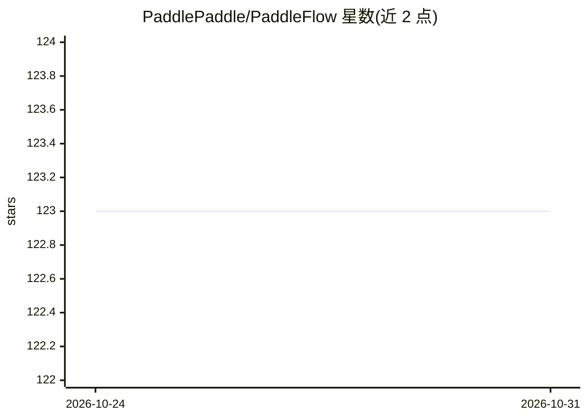

# PaddlePaddle/PaddleFlow

⭐ 123 · Go · Apache-2.0 · 推送 2026-10-23 · [GitHub](https://github.com/PaddlePaddle/PaddleFlow) · 组织维护 · 中文 README

**面向 AI 开发的 Kubernetes 资源调度与共享存储工具**

基于云原生 Kubernetes/K3s 的 AI 资源管理与调度工具，作为机器学习平台的资源核心，面向机器学习与深度学习的单机和分布式作业。提供三块能力：兼容 POSIX 的 FUSE 文件系统 PaddleFlowFS（内置两层缓存、支持 BOS 类 S3/HDFS/本地文件系统等数据源）；基于 Volcano 改造的队列调度与资源池化管理（内置 Paddle、TensorFlow 等框架引擎）；可模板化、支持断点运行的工作流编排。架构由客户端、server、改造版 volcano、CSI 插件四部分组成，提供命令行工具与 Python SDK。注意：README 中快速部署与上手内容以外部链接形式给出，当前文本不含具体安装命令。

## 筛选速览

| 维度 | 判定 | 备注 |
|---|---|---|
| AI 角色 | `ai-ecosystem` | LLM/agent 周边工具 |
| 许可风险 | `permissive` | Apache-2.0 |
| 部署形态 | `None` |  |
| 模型依赖 | — | README 未给出锁定关系 |
| 硬件要求 | — | 无带数字的原话,不猜 |
| 安装摩擦 | `low` | 无编译、无系统依赖或容器化 |
| 成熟度 | — | 结构信号不足 |

## 能力要点

- PaddleFlowFS 高性能 FUSE 文件系统，两层缓存与缓存亲和性调度
- 基于 Kubernetes 的资源池化管理与 Volcano 队列调度
- 工作流模板化编排，支持断点运行与 Artifact 管理
- 提供命令行客户端与 Python SDK

## 适用场景

- 在 Kubernetes/K3s 集群上运行和调度单机或分布式 AI 训练作业
- 多租户环境下管理 AI 作业的算力与存储资源
- 通过缓存加速远程存储数据的读写，降低访问频率
- 用工作流模板化并重复执行 AI 训练流程

## 场景标签

`MLOps` · 领域:训练与推理

## 证据(README 行号)

> L1: **PaddleFlow**简称PF，AI资源管理与调度工具。基于云原生Kubernetes或K3s，提供面向AI开发的批量作业执行系统，并且提供易用的共享文件系统，在apache license2.0 开源协议下发布。
> L2: PaddleFlow作为机器学习平台的资源核心，适用于机器学习和深度学习的单机和分布式作业，针对作业依赖的算力和存储资源进行多租户管理和调度；提供缓存编排和加速的能力，降低访问远程存储的频率，提升训练效率；提供工作流用于编排AI作业
> L20: - 2.PaddleFlow server: PaddleFlow核心服务，主要包含队列、存储、工作流等核心功能的管理。

## 星数曲线

2026-10-24 123 → 2026-10-31 123（+0）

---
*卡片 v1 · prompt 1.4 · 生成 2026-10-23 · 置信度 high · 依据 README sha `ae54544ae6d7` · [字段定义](../../DATASET.md)*
