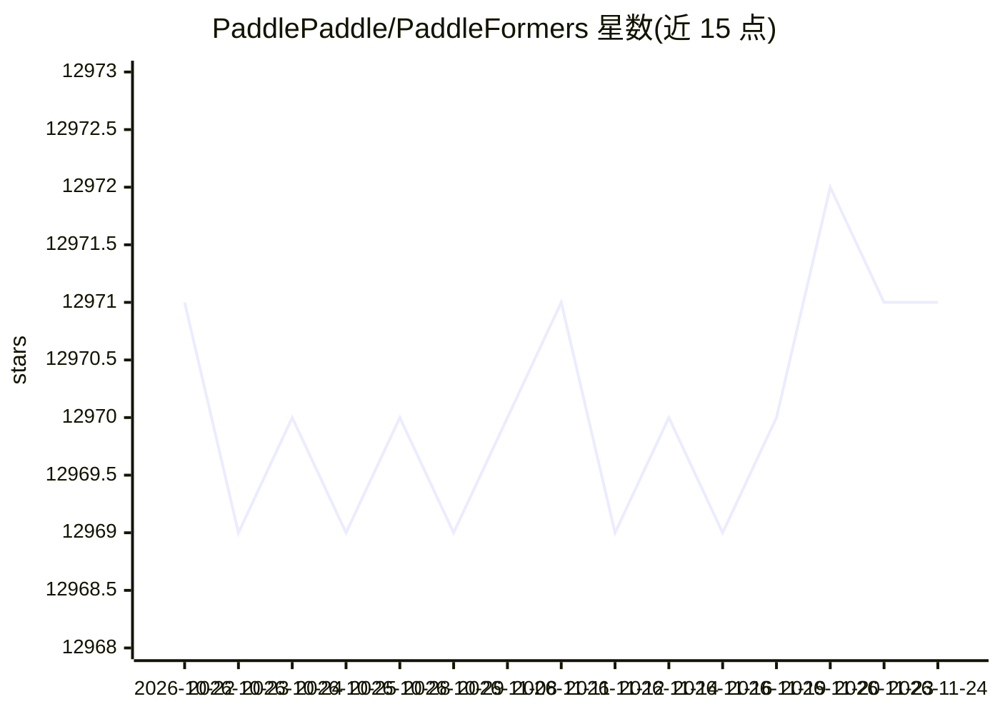

# PaddlePaddle/PaddleFormers

⭐ 12,971 · Python · Apache-2.0 · 推送 2026-11-17 · [GitHub](https://github.com/PaddlePaddle/PaddleFormers) · 组织维护 · 中文 README

**基于 PaddlePaddle 的大模型训练库，支持 LLM/VLM 预训练与后训练**

PaddleFormers 是基于 PaddlePaddle 的 Transformers 库，提供 LLM 与 VLM 的预训练与后训练（CPT/SFT/LoRA/DPO）能力，API 设计与 Hugging Face Transformers 保持一致。覆盖 100+ 主流模型系列，内置张量/流水线/专家并行等分布式训练策略与 FP8 低精度训练，并适配昆仑芯、天数智芯、沐曦等国产芯片。输出 Safetensors 权重可在 FastDeploy/vLLM/SGLang 等推理工具中使用。面向需要训练与微调大模型的开发者。

## 筛选速览

| 维度 | 判定 | 备注 |
|---|---|---|
| AI 角色 | `ai-ecosystem` | LLM/agent 周边工具 |
| 许可风险 | `permissive` | Apache-2.0 |
| 部署形态 | `self-host` | docker 或自建部署 |
| 模型依赖 | local-ok | 支持本地模型 |
| 硬件要求 | — | 无带数字的原话,不猜 |
| 安装摩擦 | `low` | 无编译、无系统依赖或容器化 |
| 成熟度 | — | 结构信号不足 |

## 能力要点

- 支持 100+ LLM/VLM 模型系列的训练能力
- 张量并行、流水线并行、专家并行等分布式训练策略与 FP8 训练
- 后训练覆盖 CPT/SFT/LoRA/DPO，支持 Function Call 与 Thinking 能力训练
- 适配昆仑芯 P800、天数天垓150、沐曦 C550 等国产芯片

## 适用场景

- 预训练或 SFT/LoRA 微调开源大模型
- 训练支持 Function Call 或思考能力的模型
- 在国产算力平台上完成大模型后训练
- 训练 VLM 实现文档识别等任务微调

## 场景标签

`微调` `模型训练` · 领域:训练与推理

## 证据(README 行号)

> L9: PaddleFormers 是基于百度深度学习框架 PaddlePaddle 搭建的 Transformers 库，旨在为 PaddlePaddle 生态提供与 Hugging Face Transformers 项目对等的模型接口
> L11: 结合业界主流优化方法与飞桨在业务实践中积累的高效特性，PaddleFormers 致力于打造**高性能、低资源占用**的训练体验，帮助用户高效便捷地完成大模型训练，而无需关注底层复杂的优化细节。
> L25: * **全流程能力支持：** PaddleFormers 实现了从预训练到后训练的全流程训练能力支持，其中后训练支持 CPT / SFT / SFT-LoRA / DPO / DPO-LoRA 等主流能力，帮助用户高效、便捷地完成

## 星数曲线

2026-10-22 12,971 → 2026-11-24 12,971（+0）

---
*卡片 v1 · prompt 1.4 · 生成 2026-11-23 · 置信度 high · 依据 README sha `fa5141f9c8a6` · [字段定义](../../DATASET.md)*
