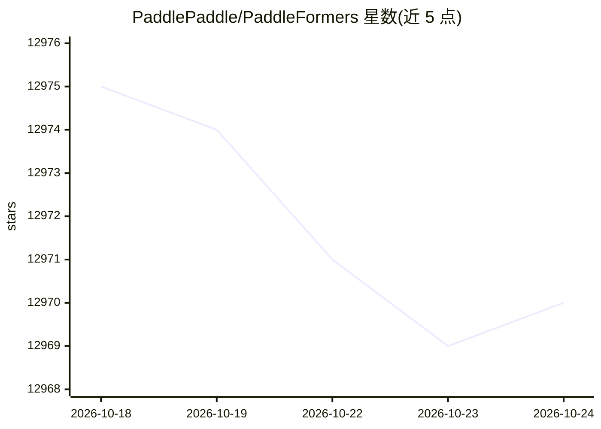

# PaddlePaddle/PaddleFormers

⭐ 12,970 · Python · Apache-2.0 · 推送 2026-10-21 · [GitHub](https://github.com/PaddlePaddle/PaddleFormers) · 组织维护 · 中文 README

**基于飞桨的大模型训练库：LLM/VLM 预训练与后训练**

PaddlePaddle 团队维护的 Transformers 库，为 PaddlePaddle 生态提供与 Hugging Face Transformers 对齐的接口与训练能力，覆盖 100+ 主流 LLM/VLM（DeepSeek-V3/V4、GLM-4.5、Qwen 系列、ERNIE-4.5 等），支持张量/流水线/专家并行的分布式训练与 FP8、自动混合精度等加速策略。训练流程覆盖预训练、CPT/SFT/LoRA/DPO，支持 Function Call、Thinking 能力训练，并提供昆仑芯、天数智芯、沐曦等国产芯片适配。API 设计与 Hugging Face Transformers 保持一致，训练产物以 Safetensors 格式存储，可在 vLLM、SGLang 等框架中部署。限制：GPU 训练依赖 Python≥3.12、CUDA≥13.0 与 PaddleFleet。

## 筛选速览

| 维度 | 判定 | 备注 |
|---|---|---|
| AI 角色 | `ai-ecosystem` | LLM/agent 周边工具 |
| 许可风险 | `permissive` | Apache-2.0 |
| 部署形态 | `self-host` | docker 或自建部署 |
| 模型依赖 | local-ok | 支持本地模型 |
| 硬件要求 | — | 无带数字的原话,不猜 |
| 安装摩擦 | `low` | 无编译、无系统依赖或容器化 |
| 成熟度 | — | 结构信号不足 |

## 能力要点

- 100+ 主流 LLM/VLM 的预训练与后训练（SFT/LoRA/DPO）支持
- 张量/流水线/专家并行分布式训练与 FP8、Data Packing、Padding Free 等优化
- API 与 Hugging Face Transformers 保持一致，Safetensors 格式产物可在 vLLM/SGLang 等使用
- 昆仑芯 P800、天数天垓150、沐曦 C550 等国产芯片适配

## 适用场景

- 在 PaddlePaddle 生态中对 DeepSeek、GLM、Qwen 等模型做 SFT/LoRA/DPO 训练
- 复用 Hugging Face 风格 API 加载 tokenizer 与模型
- 在国产算力平台上完成大模型后训练

## 场景标签

`模型训练` `微调` · 领域:训练与推理

## 证据(README 行号)

> L9: PaddleFormers 是基于百度深度学习框架 PaddlePaddle 搭建的 Transformers 库，旨在为 PaddlePaddle 生态提供与 Hugging Face Transformers 项目对等的模型接口
> L25: * **全流程能力支持：** PaddleFormers 实现了从预训练到后训练的全流程训练能力支持，其中后训练支持 CPT / SFT / SFT-LoRA / DPO / DPO-LoRA 等主流能力，帮助用户高效、便捷地完成

## 星数曲线

2026-10-18 12,975 → 2026-10-24 12,970（-5）

---
*卡片 v1 · prompt 1.4 · 生成 2026-10-20 · 置信度 high · 依据 README sha `eab8639e7e69` · [字段定义](../../DATASET.md)*
