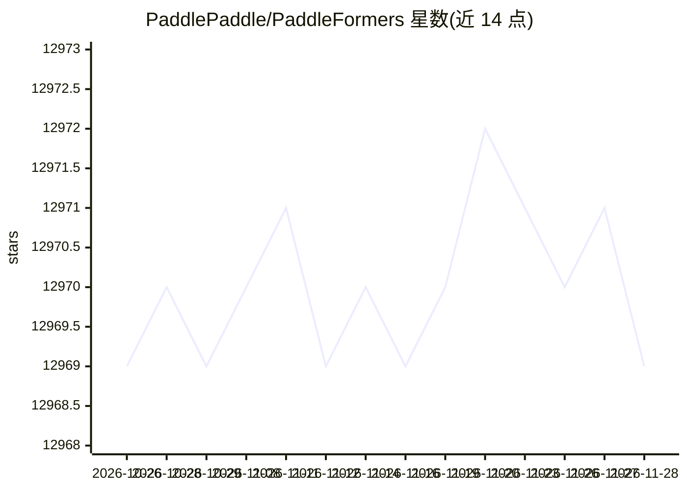

# PaddlePaddle/PaddleFormers

⭐ 12,969 · Python · Apache-2.0 · 推送 2026-11-27 · [GitHub](https://github.com/PaddlePaddle/PaddleFormers) · 组织维护 · 中文 README

**基于 PaddlePaddle 的 LLM/VLM 预训练与后训练库**

PaddleFormers 是基于百度 PaddlePaddle 框架的 Transformers 风格库，提供 LLM 与 VLM 的预训练及后训练能力（CPT/SFT/LoRA/DPO），API 设计与 Hugging Face Transformers 保持一致。支持张量/流水线/专家并行等分布式训练策略与 FP8 低精度训练，收录 100+ 主流模型系列。训练完成的模型输出 Safetensors 格式，可在支持该格式的其他推理框架中使用。提供 CLI 训练命令、tokenizer/processor 轻量安装选项，并适配昆仑芯、天数智芯、沐曦等国产计算平台。要求 Python ≥3.12、CUDA ≥13.0，推荐以 Docker 容器方式准备 GPU 环境。

## 筛选速览

| 维度 | 判定 | 备注 |
|---|---|---|
| AI 角色 | `ai-ecosystem` | LLM/agent 周边工具 |
| 许可风险 | `permissive` | Apache-2.0 |
| 部署形态 | `self-host` | docker 或自建部署 |
| 模型依赖 | local-ok | 支持本地模型 |
| 硬件要求 | — | 无带数字的原话,不猜 |
| 安装摩擦 | `low` | 无编译、无系统依赖或容器化 |
| 成熟度 | — | 结构信号不足 |

## 能力要点

- 支持 100+ LLM 与 VLM 的预训练和后训练（CPT/SFT/LoRA/DPO）
- 支持张量并行、流水线并行、专家并行与 FP8 低精度训练
- 训练产物为 Safetensors 格式，与其他支持该格式的框架互通
- 适配昆仑芯 P800、天数天垓150、沐曦 C550 等国产芯片

## 适用场景

- 对 DeepSeek、Qwen、GLM 等开源模型进行 SFT 或 LoRA 微调
- 使用国产芯片算力进行大模型后训练
- 基于 PaddlePaddle 生态开展模型预训练
- 仅需 tokenizer/processor 做文本处理与模型读取

## 场景标签

`模型训练` `微调` · 领域:训练与推理

## 证据(README 行号)

> L9: PaddleFormers 是基于百度深度学习框架 PaddlePaddle 搭建的 Transformers 库，旨在为 PaddlePaddle 生态提供与 Hugging Face Transformers 项目对等的模型接口
> L25: * **全流程能力支持：** PaddleFormers 实现了从预训练到后训练的全流程训练能力支持，其中后训练支持 CPT / SFT / SFT-LoRA / DPO / DPO-LoRA 等主流能力，帮助用户高效、便捷地完成

## 星数曲线

2026-10-26 12,969 → 2026-11-28 12,969（+0）

---
*卡片 v1 · prompt 1.4 · 生成 2026-11-26 · 置信度 high · 依据 README sha `2cb5302ebff2` · [字段定义](../../DATASET.md)*
