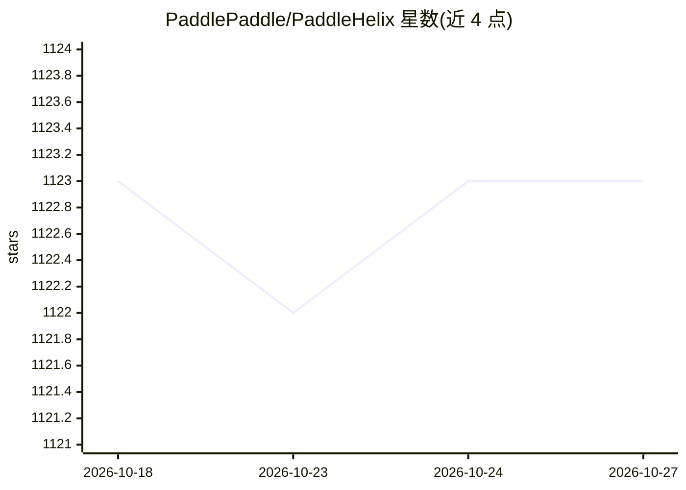

# PaddlePaddle/PaddleHelix

⭐ 1,123 · Python · NOASSERTION · 推送 2026-03-31 · [GitHub](https://github.com/PaddlePaddle/PaddleHelix) · 组织维护 · 中文 README

**生物计算工具集：药物发现、疫苗设计与精准医疗的深度学习平台**

基于 PaddlePaddle 的生物计算开源仓库，提供化合物与蛋白质大规模预训练模型，以及分子性质预测、药物-靶点亲和力预测、分子生成、药物联用协同等应用；疫苗设计方向提供 LinearFold、LinearPartition 等 RNA 二级结构算法；蛋白质结构预测方向包含 HelixFold 系列（HelixFold3 复现 AlphaFold3 能力，准确率可比）。面向药物研发与计算生物学研究者，配有教程、示例代码与竞赛方案。许可证为 CC BY-NC-SA 4.0（非商业）；另提供网页平台与付费 API 通道。

## 筛选速览

| 维度 | 判定 | 备注 |
|---|---|---|
| AI 角色 | `ai-native` | 本体是模型或模型工具 |
| 许可风险 | `none` | NOASSERTION |
| 部署形态 | `None` |  |
| 模型依赖 | — | README 未给出锁定关系 |
| 硬件要求 | — | 无带数字的原话,不猜 |
| 安装摩擦 | `low` | 无编译、无系统依赖或容器化 |
| 成熟度 | — | 结构信号不足 |

## 能力要点

- 化合物/蛋白质大规模预训练模型与多类下游应用（性质预测、DTI、分子生成）
- HelixFold/HelixFold-Single/HelixFold3 蛋白质结构预测流水线
- LinearFold、LinearPartition 等 RNA 结构预测算法
- 多篇论文发表于 Nature Machine Intelligence、NeurIPS、KDD 等会议期刊

## 适用场景

- 做分子性质预测与药物-靶点亲和力预测研究
- 运行蛋白质结构预测（HelixFold 系列）流水线
- 预测 RNA 二级结构辅助疫苗设计
- 基于源码扩展新的生物计算算法

## 场景标签

 · 领域:生物计算/药物发现

## 证据(README 行号)

> L60: PaddleHelix is a bio-computing tool, taking advantage of the machine learning approaches, especially deep neural ne
> L61: * **Drug Discovery**. Provide 1) Large-scale pre-training models: compounds and proteins; 2) Various applications: 

## 星数曲线

2026-10-18 1,123 → 2026-10-27 1,123（+0）

---
*卡片 v1 · prompt 1.4 · 生成 2026-10-21 · 置信度 high · 依据 README sha `30cd64fcac2b` · [字段定义](../../DATASET.md)*
