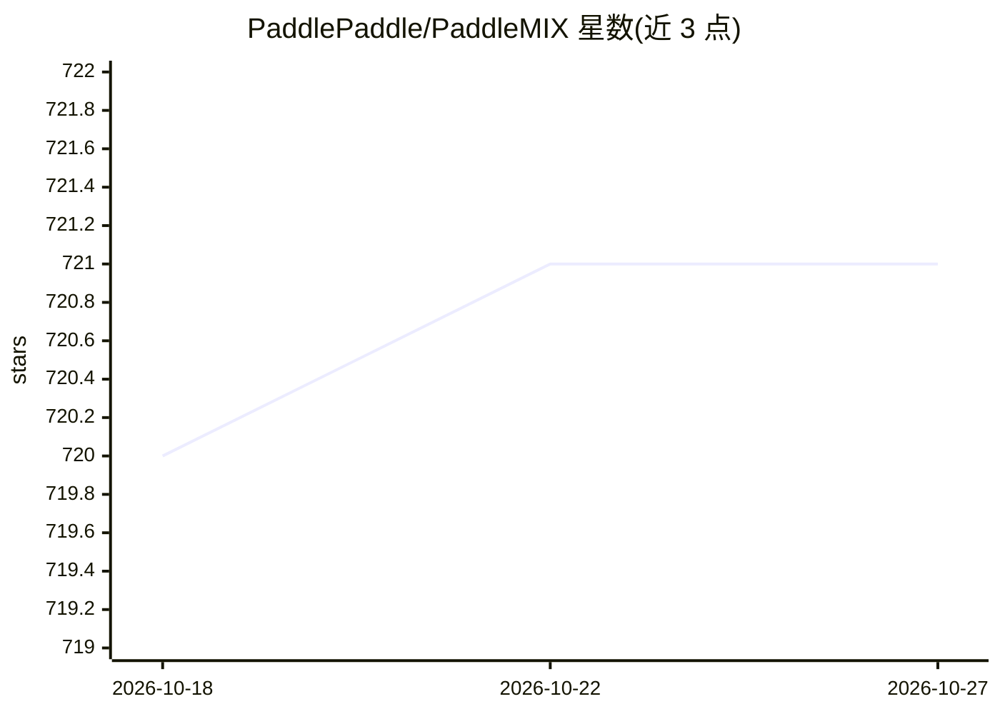

# PaddlePaddle/PaddleMIX

⭐ 721 · Python · Apache-2.0 · 推送 2026-03-06 · [GitHub](https://github.com/PaddlePaddle/PaddleMIX) · 组织维护 · 中文 README

**基于飞桨的多模态大模型开发套件，覆盖训推全流程**

PaddleMIX 是基于飞桨的多模态大模型开发套件，面向开发者，聚合图像、文本、视频等模态，覆盖视觉语言预训练、微调、推理部署、文生图、文生视频、多模态理解等任务。包含 PPDiffusers 扩散模型工具箱、自研文档理解模型 PP-DocBee、可控视频生成模型 PP-VCtrl、数据处理工具箱 DataCopilot 与数据能力标签模型 PP-InsCapTagger。支持昇腾 910B、昆仑 P800 等硬件。通过 git clone 源码加 pip install -e 安装。

## 筛选速览

| 维度 | 判定 | 备注 |
|---|---|---|
| AI 角色 | `ai-ecosystem` | LLM/agent 周边工具 |
| 许可风险 | `permissive` | Apache-2.0 |
| 部署形态 | `library` | 以包/库形式分发 |
| 模型依赖 | — | README 未给出锁定关系 |
| 硬件要求 | — | 无带数字的原话,不猜 |
| 安装摩擦 | `medium` | 含编译或系统依赖之一 |
| 成熟度 | — | 结构信号不足 |

## 能力要点

- 覆盖数据处理、预训练、精调、推理部署的全流程开发体验
- 内置 PPDiffusers 扩散模型工具箱与 Fast-Diffusers 推理加速包
- 自研 PP-DocBee 文档理解模型与 PP-VCtrl 可控视频生成模型
- DataCopilot 数据工具箱与 PP-InsCapTagger 数据能力打标模型

## 适用场景

- 在统一套件中训练和微调 LLaVA、Qwen-VL、InternVL2 等多模态大模型
- 使用 SD3、FLUX 等扩散模型进行文生图与视频生成开发
- 对多模态训练数据集做打标分析与优化
- 在昇腾等国产硬件上运行多模态模型训练与推理

## 场景标签

`多模态` `微调` `模型训练` `图像生成` · 领域:内容生成

## 证据(README 行号)

> L53: PaddleMIX是基于飞桨的多模态大模型开发套件，聚合图像、文本、视频等多种模态，覆盖视觉语言预训练，微调，文生图，文生视频，多模态理解等丰富的多模态任务。它提供开箱即用的开发体验，同时支持灵活定制，满足不同需求，助力探索通用人
> L70: PaddleMIX 向开发者提供全流程多模态大模型开发体验，包括数据处理，模型开发，预训练，精调，推理部署。并针对不同任务提供了推荐模型最佳实践。`传送门`：📱最佳实践

## 星数曲线

2026-10-18 720 → 2026-10-27 721（+1）

---
*卡片 v1 · prompt 1.4 · 生成 2026-10-21 · 置信度 high · 依据 README sha `9d7990840db5` · [字段定义](../../DATASET.md)*
