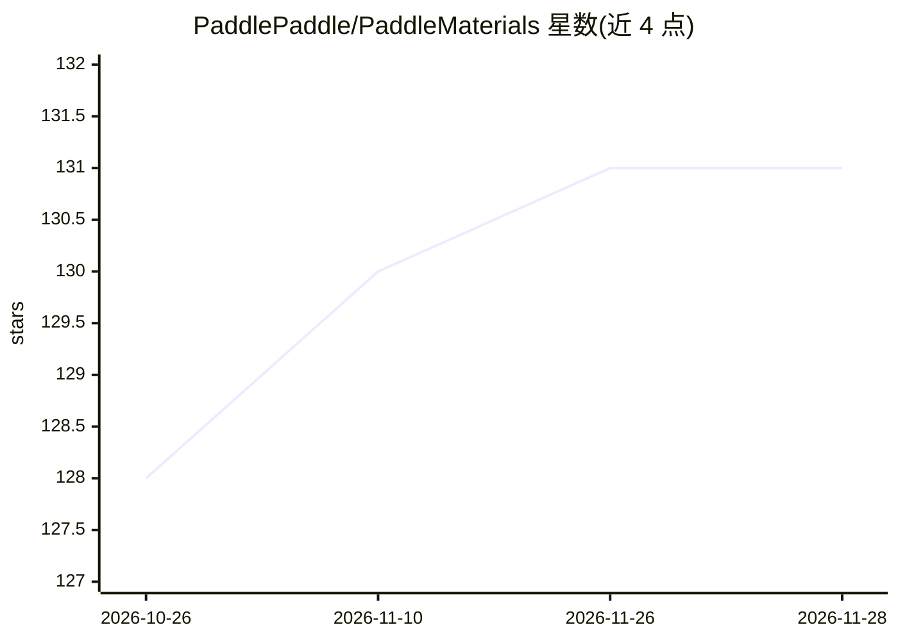

# PaddlePaddle/PaddleMaterials

⭐ 131 · Python · Apache-2.0 · 推送 2026-11-20 · [GitHub](https://github.com/PaddlePaddle/PaddleMaterials) · [官网](https://paddlepaddle.github.io/PaddleMaterials/) · 组织维护

**材料科学研究者的端到端深度学习工具包**

基于 PaddlePaddle 框架构建的 AI4Materials 工具包，定位为材料科学基础模型开发与部署平台。覆盖六类任务：性能预测（形成能、带隙、弹性模量）、晶体结构生成、机器学习原子间势、电子结构预测、NMR 谱图解析结构、显微与谱图信号增强。内置 50+ 预训练模型（MEGNet、MatterGen、CHGNet、DiffNMR 等）与多套数据集，支持分布式训练、混合精度与断点恢复；安装文档按硬件环境区分。

## 筛选速览

| 维度 | 判定 | 备注 |
|---|---|---|
| AI 角色 | `ai-native` | 本体是模型或模型工具 |
| 许可风险 | `permissive` | Apache-2.0 |
| 部署形态 | `library` | 以包/库形式分发 |
| 模型依赖 | — | README 未给出锁定关系 |
| 硬件要求 | — | 无带数字的原话,不猜 |
| 安装摩擦 | `low` | 无编译、无系统依赖或容器化 |
| 成熟度 | — | 结构信号不足 |

## 能力要点

- 六类任务统一框架：PP/SG/MLIP/ES/SE/SPEN
- 50+ 预训练模型可直接推理，附各任务示例命令
- 支持 NVIDIA GPU、MetaX GPU 与 Intel CPU
- 支持无晶体与有机分子（含小分子与部分聚合物）数据集与模型

## 适用场景

- 从晶体结构预测形成能、带隙等材料性质
- 用扩散模型生成新颖晶体结构做逆向设计
- 训练机器学习势跑分子动力学模拟替代 DFT
- 从 NMR 谱图重构分子结构或增强 STEM 图像

## 场景标签

`模型训练` `科研工具` · 领域:学习与行业

## 证据(README 行号)

> L27: **PaddleMaterials** is an end-to-end AI4Materials toolkit built on the **PaddlePaddle** deep learning framework. De
> L33: |**Property Prediction (PP)**|Predict material properties from structure|Forward design or predict formation energy
> L86: Predict material formation energy using a pretrained MEGNet model:

## 星数曲线

2026-10-26 128 → 2026-11-28 131（+3）

---
*卡片 v1 · prompt 1.4 · 生成 2026-11-28 · 置信度 mid · 依据 README sha `b26c8c3f4b55` · [字段定义](../../DATASET.md)*
