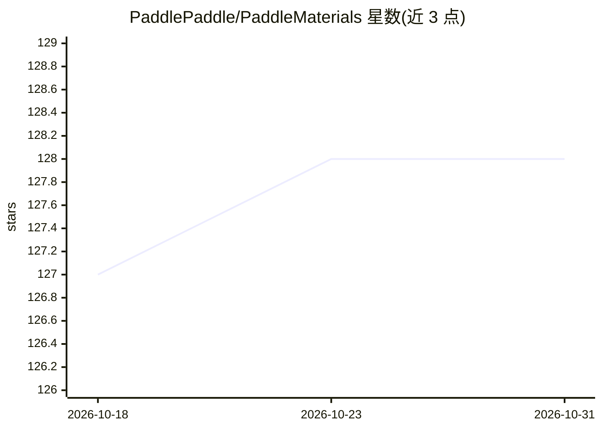

# PaddlePaddle/PaddleMaterials

⭐ 128 · Python · Apache-2.0 · 推送 2026-09-04 · [GitHub](https://github.com/PaddlePaddle/PaddleMaterials) · [官网](https://paddlepaddle.github.io/PaddleMaterials/) · 组织维护 · 中文 README

**材料科学 AI 工具包：性质预测/结构生成/势函数/光谱解析**

基于 PaddlePaddle 深度学习框架的端到端 AI4Materials 工具包，面向材料科学研究者，用于开发和部署材料科学基础模型。覆盖六大任务：性质预测、晶体结构生成（扩散模型）、机器学习原子间势（DFT 代理模型）、电子结构预测、NMR 光谱结构解析与显微/光谱信号增强。提供 50+ 预训练模型与多套数据集，支持分布式训练、混合精度与断点恢复，需 Python 3.10+，经 PyPI（ppmat）分发，Apache 2.0 许可。

## 筛选速览

| 维度 | 判定 | 备注 |
|---|---|---|
| AI 角色 | `ai-native` | 本体是模型或模型工具 |
| 许可风险 | `permissive` | Apache-2.0 |
| 部署形态 | `library` | 以包/库形式分发 |
| 模型依赖 | — | README 未给出锁定关系 |
| 硬件要求 | — | 无带数字的原话,不猜 |
| 安装摩擦 | `low` | 无编译、无系统依赖或容器化 |
| 成熟度 | — | 结构信号不足 |

## 能力要点

- 50+ 预训练模型覆盖 PP/SG/MLIP/ES/SE/SPEN 六类任务
- 每类任务提供命令行推理与训练入口（预训练权重直接加载）
- 多硬件支持：NVIDIA GPU、MetaX GPU、Intel CPU
- 收录 MEGNet、MatterGen、DiffCSP、CHGNet、MatterSim 等模型实现

## 适用场景

- 用预训练模型从晶体结构预测形成能、带隙等性质
- 用扩散模型生成新晶体结构做逆向设计
- 用 ML 势替代 DFT 跑分子动力学模拟
- 从 NMR 谱重建分子结构或增强 STEM 图像

## 场景标签

`图像视频处理` · 领域:感知与多模态

## 证据(README 行号)

> L27: **PaddleMaterials** is an end-to-end AI4Materials toolkit built on the **PaddlePaddle** deep learning framework. De
> L31: |Task|Description|Typical Applications|
> L33: |**Property Prediction (PP)**|Predict material properties from structure|Forward design or predict formation energy

## 星数曲线

2026-10-18 127 → 2026-10-31 128（+1）

---
*卡片 v1 · prompt 1.4 · 生成 2026-10-23 · 置信度 high · 依据 README sha `128b08296a62` · [字段定义](../../DATASET.md)*
