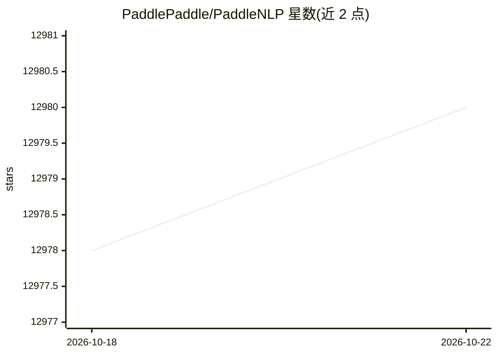

# PaddlePaddle/PaddleNLP

⭐ 12,980 · Python · Apache-2.0 · 推送 2026-05-23 · [GitHub](https://github.com/PaddlePaddle/PaddleNLP) · [官网](https://paddlenlp.readthedocs.io) · 组织维护 · 中文 README

**基于飞桨的大语言模型开发套件：训练、压缩、推理全流程**

PaddleNLP 是基于飞桨深度学习框架的大语言模型开发套件，面向需要产业级大模型训练与部署的开发者。提供预训练（4D 并行、Unified Checkpoint 存储）、精调与对齐（SFT、LoRA、DPO 等）、量化压缩（INT8/INT4/FP8）与高性能推理模块；支持 Qwen、Llama、DeepSeek 等 20 余个模型系列，并支持英伟达 GPU、昆仑 XPU、昇腾 NPU 等多硬件切换。通过 pip 安装，依赖 paddlepaddle>=3.0.0rc1 与 Python>=3.8。

## 筛选速览

| 维度 | 判定 | 备注 |
|---|---|---|
| AI 角色 | `ai-ecosystem` | LLM/agent 周边工具 |
| 许可风险 | `permissive` | Apache-2.0 |
| 部署形态 | `library` | 以包/库形式分发 |
| 模型依赖 | — | README 未给出锁定关系 |
| 硬件要求 | — | 无带数字的原话,不猜 |
| 安装摩擦 | `low` | 无编译、无系统依赖或容器化 |
| 成熟度 | — | 结构信号不足 |

## 能力要点

- 4D 并行预训练与 Unified Checkpoint 断点存储/压缩
- SFT、LoRA、Prefix Tuning、DPO/RLHF 等精调与对齐支持
- INT8/INT4/FP8 量化与高性能并行推理
- 支持英伟达 GPU、昆仑 XPU、昇腾 NPU、燧原 GCU、海光 DCU 多硬件

## 适用场景

- 在自己的数据上对开源大模型做精调与对齐训练
- 将大模型量化压缩后进行推理部署
- 在国产硬件上训练和运行主流开源模型

## 场景标签

`模型训练` `微调` `强化学习` `模型量化` · 领域:训练与推理

## 证据(README 行号)

> L11: **PaddleNLP**是一款基于飞桨深度学习框架的大语言模型(LLM)开发套件，支持在多种硬件上进行高效的大模型训练、无损压缩以及高性能推理。PaddleNLP 具备**简单易用**和**性能极致**的特点，致力于助力开发者实
> L50: 支持英伟达 GPU、昆仑 XPU、昇腾 NPU、燧原 GCU 和海光 DCU 等多个硬件的大模型和自然语言理解模型训练和推理，套件接口支持硬件快速切换，大幅降低硬件切换研发成本。
> L55: 支持纯数据并行策略、分组参数切片的数据并行策略、张量模型并行策略和流水线模型并行策略的4D 高性能训练，Trainer 支持分布式策略配置化，降低复杂分布式组合带来的使用成本；

## 星数曲线

2026-10-18 12,978 → 2026-10-22 12,980（+2）

---
*卡片 v1 · prompt 1.4 · 生成 2026-10-20 · 置信度 high · 依据 README sha `26a967639db6` · [字段定义](../../DATASET.md)*
