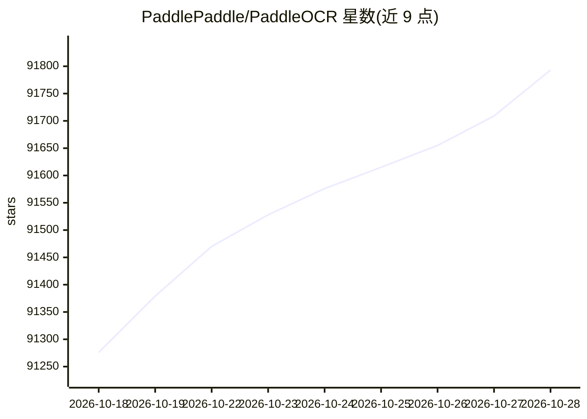

# PaddlePaddle/PaddleOCR

⭐ 91,864 · Python · Apache-2.0 · 推送 2026-09-16 · [GitHub](https://github.com/PaddlePaddle/PaddleOCR) · [官网](https://www.paddleocr.com) · 组织维护 · 中文 README

**将 PDF/图片文档转为结构化数据的 OCR 与文档解析工具包**

PaddleOCR 将 PDF 与图像转换为 JSON/Markdown 等结构化格式，供下游 LLM/RAG/Agent 应用使用。核心机制包括：面向文档解析的轻量视觉语言模型 PaddleOCR-VL（0.9B）、提供细粒度坐标信息的 PP-StructureV3、支持 100+ 语言的 PP-OCR 系列文本识别模型，以及面向 LLM 微调的数据集构建流水线。以 Python 工具包形式发布于 PyPI，另提供浏览器端 PaddleOCR.js 与 C++ 本地部署方案，支持 NVIDIA GPU、Intel CPU、昆仑芯 XPU 等硬件后端。

## 筛选速览

| 维度 | 判定 | 备注 |
|---|---|---|
| AI 角色 | `ai-native` | 本体是模型或模型工具 |
| 许可风险 | `permissive` | Apache-2.0 |
| 部署形态 | `library` | 以包/库形式分发 |
| 模型依赖 | local-ok | 支持本地模型 |
| 硬件要求 | — | 无带数字的原话,不猜 |
| 安装摩擦 | `medium` | 含编译或系统依赖之一 |
| 成熟度 | — | 结构信号不足 |

## 动量与使用信号

- 维护:`active` — 距上次 push 32.2 天,年发版 8,283 位贡献者
- 涨星:近 1 天 **+65**(自 20261016 起算)
- 平台:LINUX · 协议:OPENAI-API

## 能力要点

- PaddleOCR-VL-0.9B 文档解析 VLM，输出 Markdown/JSON，支持 109 种语言
- PP-StructureV3 将复杂 PDF/图像转为 Markdown 或 JSON 并提供表格单元格与文本坐标
- PP-OCRv6 单模型统一支持 50 种语言，提供 tiny/small/medium 三档部署规模
- 提供 LLM 训练数据集构建流水线，并与 Dify、RAGFlow 等框架集成

## 适用场景

- 把 PDF 论文、报告批量转成 Markdown 喂给 RAG 知识库
- 识别身份证、街景、书籍、工业部件等自然场景中的文字
- 解析含表格、公式、印章、图表的复杂版面文档
- 为 LLM 微调构建高质量的文本识别训练数据

## 场景标签

`文档解析` `OCR` · 领域:知识与检索

## 证据(README 行号)

> L17: **PaddleOCR converts PDF documents and images into structured, LLM-ready data (JSON/Markdown) with industry-leading
> L24: * **SOTA Document VLM**: Featuring **PaddleOCR-VL-1.6 (0.9B)**, the industry's leading lightweight vision-language 
> L39: * **LLM Data Flywheel**: A complete pipeline to build high-quality datasets, providing a sustainable "Data Engine" 

## 星数曲线

2026-10-18 91,276 → 2026-10-28 91,793（+517）

---
*卡片 v1 · prompt 1.4 · 生成 2026-10-18 · 置信度 high · 依据 README sha `9ac51c8d61ce` · [字段定义](../../DATASET.md)*
