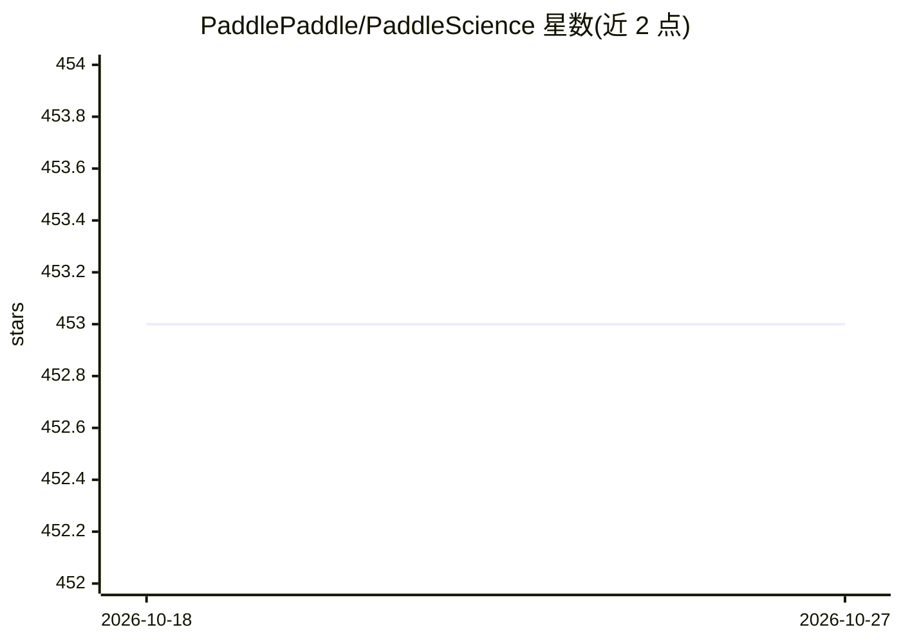

# PaddlePaddle/PaddleScience

⭐ 453 · Python · Apache-2.0 · 推送 2026-10-14 · [GitHub](https://github.com/PaddlePaddle/PaddleScience) · [官网](http://paddlescience-docs.rtfd.io/) · 组织维护 · 中文 README

**基于 PaddlePaddle 的 AI 科学计算套件，求解物理/化学/气象问题**

面向科研与工程用户的科学计算 SDK 与库，基于深度学习框架 PaddlePaddle 构建，利用深度神经网络与自动(高阶)微分机制，支持物理机理驱动、数据驱动、数理融合三种求解方式。提供几何采样与布尔运算、Dirichlet/Neumann/Robin 及自定义边界条件、基于 sympy 的符号方程表示、多任务学习模块，覆盖流体、结构、气象、材料、化学等领域 20+ 案例。需先安装 PaddlePaddle 3.0 以上版本，可选 pip、conda、git 源码等方式安装，遵循 Apache 2.0 协议。

## 筛选速览

| 维度 | 判定 | 备注 |
|---|---|---|
| AI 角色 | `ai-ecosystem` | LLM/agent 周边工具 |
| 许可风险 | `permissive` | Apache-2.0 |
| 部署形态 | `library` | 以包/库形式分发 |
| 模型依赖 | — | README 未给出锁定关系 |
| 硬件要求 | — | 无带数字的原话,不猜 |
| 安装摩擦 | `low` | 无编译、无系统依赖或容器化 |
| 成熟度 | — | 结构信号不足 |

## 能力要点

- 支持机理驱动、数据驱动、数理融合三种求解方式
- 覆盖数学、技术、材料、地球、化学科学等领域的 20+ 案例
- 支持简单几何与复杂 STL 几何的采样与布尔运算
- 基于 sympy 的方程表示与联立方程组计算

## 适用场景

- 用 PINN 等方法求解偏微分方程（流体、结构、热仿真等）
- 复现天气预报、气象降尺度等 AI for Science 案例
- 做分子生成、材料属性预测等数据驱动科研任务

## 场景标签

`科研工具` · 领域:学习与行业

## 证据(README 行号)

> L24: PaddleScience 是一个基于深度学习框架 PaddlePaddle 开发的科学计算套件，利用深度神经网络的学习能力和 PaddlePaddle 框架的自动(高阶)微分机制，解决物理、化学、气象等领域的问题。支持物理机理驱
> L33: - 支持物理机理驱动、数据驱动、数理融合三种问题求解方式。涵盖流体、结构、气象等领域 20+ 案例。

## 星数曲线

2026-10-18 453 → 2026-10-27 453（+0）

---
*卡片 v1 · prompt 1.4 · 生成 2026-10-21 · 置信度 high · 依据 README sha `9018901329f6` · [字段定义](../../DATASET.md)*
