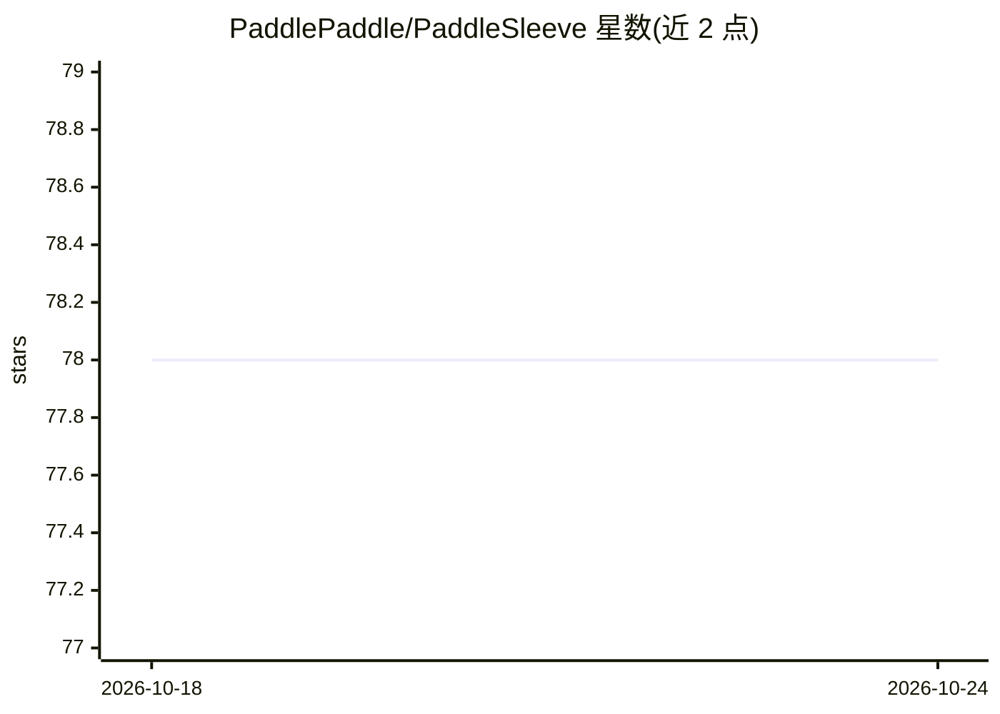

# PaddlePaddle/PaddleSleeve

⭐ 78 · Python · Apache-2.0 · 推送 2026-02-03 · [GitHub](https://github.com/PaddlePaddle/PaddleSleeve) · 组织维护 · 中文 README

**飞桨模型安全与隐私评测及防护工具集**

基于 PaddlePaddle 的 AI 安全与隐私工具集，包含五个模块：AdvBox 集成 FGSM/PGD 等对抗样本攻击算法及对抗训练、去噪防御；Robustness 用光照、天气等拟自然扰动评估模型鲁棒性；PrivBox 提供模型逆向、成员推理、模型窃取等隐私攻击实现及评估指标；PrivacyGuard 提供差分隐私优化器、梯度压缩、置信度模糊化等防护；CodeSecurity 用 Fuzzing 与 CodeQL 做代码审计；Paddle-LiTEE 基于 ARM TrustZone 实现端侧模型 TEE 内解密推理。面向使用飞桨的模型开发者与安全研究者，Apache-2.0 许可。

## 筛选速览

| 维度 | 判定 | 备注 |
|---|---|---|
| AI 角色 | `ai-ecosystem` | LLM/agent 周边工具 |
| 许可风险 | `permissive` | Apache-2.0 |
| 部署形态 | `None` |  |
| 模型依赖 | — | README 未给出锁定关系 |
| 硬件要求 | — | 无带数字的原话,不猜 |
| 安装摩擦 | `low` | 无编译、无系统依赖或容器化 |
| 成熟度 | — | 结构信号不足 |

## 能力要点

- 黑白盒对抗样本攻击与拟自然扰动鲁棒性评测
- 模型逆向/成员推理/模型窃取等隐私攻击实现与 AUC/PSNR/SSIM 评估指标
- 差分隐私优化器（DP-SGD/DP-Adam 等）与对抗训练等防护手段
- 基于 ARM TrustZone 的端侧模型 TEE 保护（Paddle-LiTEE）

## 适用场景

- 评测我的飞桨模型在对抗样本和环境干扰下的鲁棒性
- 检测模型是否存在训练数据泄露等隐私风险
- 通过对抗训练或差分隐私加固已部署模型

## 场景标签

`模型评测` `网络安全` · 领域:评测与运维

## 证据(README 行号)

> L3: **PaddleSleeve是基于百度开源深度学习平台飞桨的安全与隐私工具**，为AI产业实践提供丰富、有效、易用的模型安全及隐私评测及保护能力。
> L15: - **模型攻击与评估**
> L19: - **模型防御**

## 星数曲线

2026-10-18 78 → 2026-10-24 78（+0）

---
*卡片 v1 · prompt 1.4 · 生成 2026-10-24 · 置信度 high · 依据 README sha `5e2c52ae1337` · [字段定义](../../DATASET.md)*
