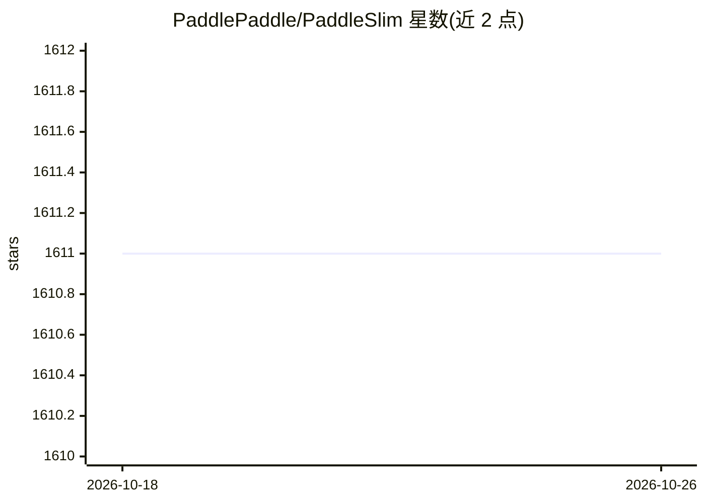

# PaddlePaddle/PaddleSlim

⭐ 1,611 · Python · Apache-2.0 · 推送 2026-01-04 · [GitHub](https://github.com/PaddlePaddle/PaddleSlim) · [官网](https://paddleslim.readthedocs.io/zh_CN/latest/) · 组织维护 · 中文 README

**面向开发者的深度学习模型压缩工具库（量化/蒸馏/剪枝/NAS）**

PaddlePaddle 生态下的模型压缩库，提供低比特量化（QAT/PTQ/Embedding 量化）、知识蒸馏、结构化剪枝与 NAS 模型结构搜索等策略，帮助开发者实现模型小型化。支持代码无感知的自动化压缩：只需提供推理模型文件和数据即可执行离线量化、量化训练、稀疏训练，并可自动搜索压缩策略组合。配套量化分析、延时预估工具及检测/分割/OCR/NLP 压缩示例；量化部署依赖 Paddle Inference/Paddle Lite/ONNX，README 更新停留在 2022 年。

## 筛选速览

| 维度 | 判定 | 备注 |
|---|---|---|
| AI 角色 | `ai-ecosystem` | LLM/agent 周边工具 |
| 许可风险 | `permissive` | Apache-2.0 |
| 部署形态 | `library` | 以包/库形式分发 |
| 模型依赖 | — | README 未给出锁定关系 |
| 硬件要求 | — | 无带数字的原话,不猜 |
| 安装摩擦 | `low` | 无编译、无系统依赖或容器化 |
| 成熟度 | — | 结构信号不足 |

## 能力要点

- 低比特量化（QAT、静态/动态 PTQ、Embedding 量化）与 7 种以上离线量化方法
- 自动化压缩：仅需推理模型与数据，支持自动策略选择
- 结构化剪枝、稀疏化、多种 NAS（DARTS/PC-DARTS/Once-for-All/RL）
- 延时预估工具，支持 SD625/SD710/RK3288 + Paddle Lite 性能预估

## 适用场景

- 把 YOLO、BERT 等 CV/NLP 模型做量化或剪枝后部署到移动端/边缘设备
- 用离线量化在无重训练条件下缩小推理模型
- 通过 NAS 搜索适配部署环境的模型结构

## 场景标签

`模型量化` · 领域:训练与推理

## 证据(README 行号)

> L3: PaddleSlim是一个专注于深度学习模型压缩的工具库，提供**低比特量化、知识蒸馏、稀疏化和模型结构搜索**等模型压缩策略，帮助开发者快速实现模型的小型化。
> L30:  - 支持代码无感知压缩：开发者只需提供推理模型文件和数据，既可进行离线量化（PTQ）、量化训练（QAT）、稀疏训练等压缩任务。
> L31:  - 支持自动策略选择，根据任务特点和部署环境特性：自动搜索合适的离线量化方法,自动搜索最佳的压缩策略组合方式。

## 星数曲线

2026-10-18 1,611 → 2026-10-26 1,611（+0）

---
*卡片 v1 · prompt 1.4 · 生成 2026-10-21 · 置信度 high · 依据 README sha `a7c0f19212f6` · [字段定义](../../DATASET.md)*
