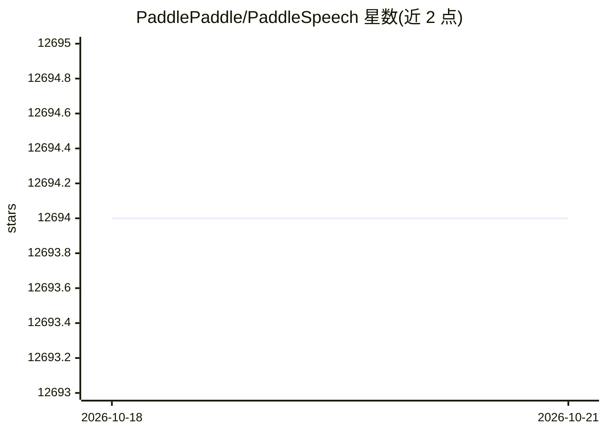

# PaddlePaddle/PaddleSpeech

⭐ 12,694 · Python · Apache-2.0 · 推送 2026-08-12 · [GitHub](https://github.com/PaddlePaddle/PaddleSpeech) · [官网](https://paddlespeech.readthedocs.io) · 组织维护 · 中文 README

**飞桨平台的语音工具包：ASR/TTS/声纹/翻译/标点等全栈语音任务**

PaddleSpeech 是基于 PaddlePaddle 深度学习平台的开源语音工具包，覆盖语音识别（含流式 ASR 与标点恢复）、语音合成（含规则式中文文本前端、流式 TTS）、语音翻译（英译中）、说话人验证、关键词检出、音频分类、声音克隆与歌声合成等任务。提供 CLI、Python API 与 Server/流式 Server 三种使用方式，包含训练、推理、测试与部署模块。依赖 paddlepaddle 框架，推荐 Linux（python>=3.8，gcc>=4.8.5），也支持 Windows 与 Mac OSX。

## 筛选速览

| 维度 | 判定 | 备注 |
|---|---|---|
| AI 角色 | `ai-native` | 本体是模型或模型工具 |
| 许可风险 | `permissive` | Apache-2.0 |
| 部署形态 | `library` | 以包/库形式分发 |
| 模型依赖 | — | README 未给出锁定关系 |
| 硬件要求 | — | 无带数字的原话,不猜 |
| 安装摩擦 | `medium` | 含编译或系统依赖之一 |
| 成熟度 | — | 结构信号不足 |

## 能力要点

- 流式 ASR 与流式 TTS 系统，含标点恢复与时间戳
- 规则式中文文本前端：文本正则化与 G2P（多音字、变调）
- 覆盖声纹提取、音频分类、语音翻译、关键词检出、声音克隆等任务
- 提供 CLI、Python API 与 Server（含流式）三种使用方式

## 适用场景

- 用命令行或 Python API 做中英文语音识别与合成
- 部署流式语音识别/合成服务供业务系统调用
- 恢复 ASR 输出文本的标点，或做说话人声纹验证

## 场景标签

`语音识别` `语音合成` · 领域:内容生成

## 证据(README 行号)

> L10: **PaddleSpeech** is an open-source toolkit on PaddlePaddle platform for a variety of critical tasks in speech and a
> L92:  - 🛎️ *Implementation of critical audio tasks*: this toolkit contains audio functions like Automatic Speech Recogni

## 星数曲线

2026-10-18 12,694 → 2026-10-21 12,694（+0）

---
*卡片 v1 · prompt 1.4 · 生成 2026-10-20 · 置信度 high · 依据 README sha `7f08eeb2a496` · [字段定义](../../DATASET.md)*
