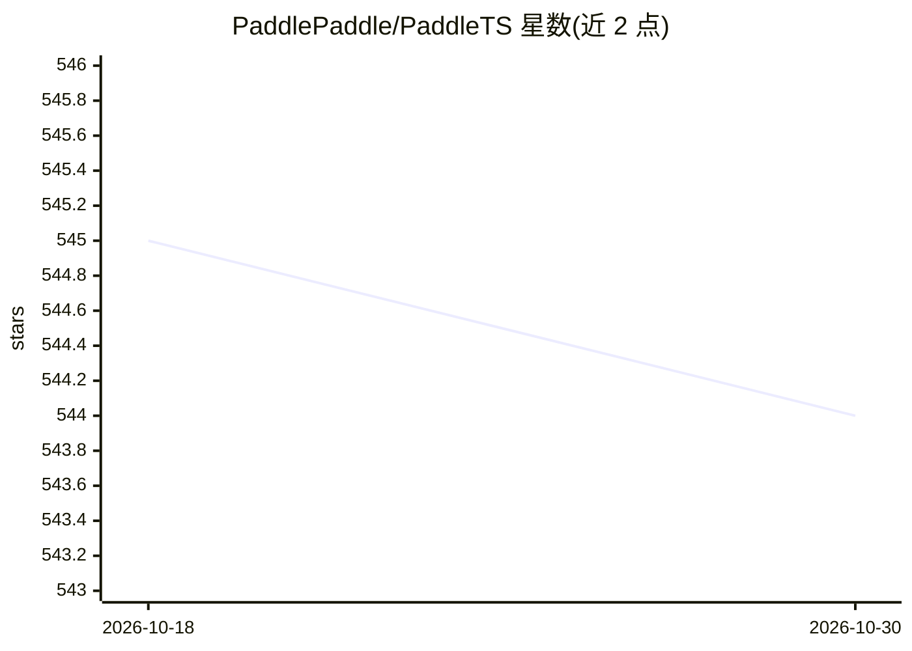

# PaddlePaddle/PaddleTS

⭐ 544 · Python · Apache-2.0 · 推送 2026-04-17 · [GitHub](https://github.com/PaddlePaddle/PaddleTS) · 组织维护 · 中文 README

**基于飞桨的深度时序建模 Python 库，覆盖预测/异常检测等任务**

PaddleTS 是基于 PaddlePaddle 的 Python 时序建模库，面向领域专家与行业用户。提供统一时序数据结构、数据转换与分析算子，内置 NBEATS、NHiTS、DeepAR、Informer、PatchTST、TimesNet 等预测模型，TS2Vec、CoST 等表征模型，Autoencoder、VAE、AnomalyTransformer 等异常检测模型，以及分类模型。含 AutoTS 自动超参寻优、任务流 pipeline、集成学习与可解释性模块，支持 GPU 运行与 sklearn、pyod 等第三方库自动集成。采用 Apache 风格许可证。

## 筛选速览

| 维度 | 判定 | 备注 |
|---|---|---|
| AI 角色 | `ai-native` | 本体是模型或模型工具 |
| 许可风险 | `permissive` | Apache-2.0 |
| 部署形态 | `None` |  |
| 模型依赖 | — | README 未给出锁定关系 |
| 硬件要求 | — | 无带数字的原话,不猜 |
| 安装摩擦 | `low` | 无编译、无系统依赖或容器化 |
| 成熟度 | — | 结构信号不足 |

## 能力要点

- 内置预测/表征/异常检测/分类四类深度时序模型（NBEATS、DeepAR、PatchTST、TimesNet 等）
- AutoTS 自动超参寻优，支持多类型 HPO 算法
- 统一 TSDataset 数据结构与 pipeline 任务流，集成 sklearn、pyod 第三方库
- 支持 GPU 设备运行，提供模型集成与可解释性（xai）模块

## 适用场景

- 我用时序数据做预测、异常检测或分类任务的模型开发
- 我需要自动超参调优来训练时序模型
- 我基于飞桨生态做时序建模并需要回测与评估工具

## 场景标签

 · 领域:时间序列分析/深度学习

## 证据(README 行号)

> L3: PaddleTS 是一个易用的深度时序建模的Python库，它基于飞桨深度学习框架PaddlePaddle，专注业界领先的深度模型，旨在为领域专家和行业用户提供可扩展的时序建模能力和便捷易用的用户体验。PaddleTS 的主要特性包
> L7: * 内置业界领先的深度学习模型，包括NBEATS、NHiTS、LSTNet、TCN、Transformer、DeepAR、Informer等时序预测模型，

## 星数曲线

2026-10-18 545 → 2026-10-30 544（-1）

---
*卡片 v1 · prompt 1.4 · 生成 2026-10-21 · 置信度 high · 依据 README sha `491900b8e030` · [字段定义](../../DATASET.md)*
