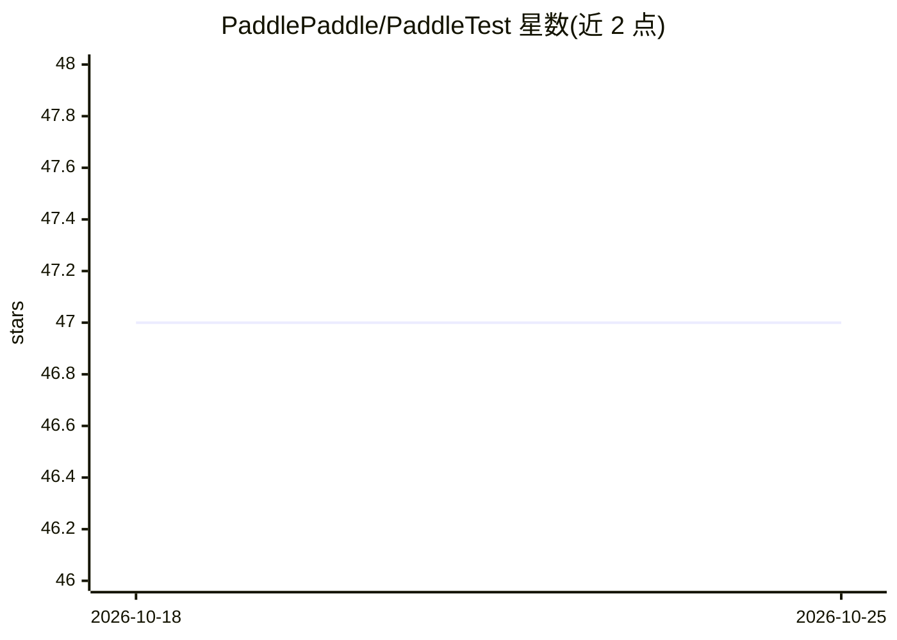

# PaddlePaddle/PaddleTest

⭐ 47 · Python · 推送 2026-08-20 · [GitHub](https://github.com/PaddlePaddle/PaddleTest) · 组织维护 · 中文 README

**PaddlePaddle 测试套件仓库：框架/预测/模型的 CI 测试与代码规范**

PaddlePaddle 官方组织的测试用例仓库，按框架、预测、模型三类内容组织 CI 任务，通过 commit 关键字（如 test=linux_ci、run_mode=framework）控制触发哪些 CI 流水线，合入要求通过全部 CI 检测并配备 QA Reviewer。代码审查基于 pre-commit（black/flake8/pylint）与 tools/codestyle 下的自定义规则，在 CI 阶段执行，也可本地 pip 安装 pre-commit 后运行。面向 PaddlePaddle 框架的贡献者与测试工程师。

## 筛选速览

| 维度 | 判定 | 备注 |
|---|---|---|
| AI 角色 | `ai-ecosystem` | LLM/agent 周边工具 |
| 许可风险 | `none` | — |
| 部署形态 | `library` | 以包/库形式分发 |
| 模型依赖 | — | README 未给出锁定关系 |
| 硬件要求 | — | 无带数字的原话,不猜 |
| 安装摩擦 | `low` | 无编译、无系统依赖或容器化 |
| 成熟度 | — | 结构信号不足 |

## 能力要点

- 按框架/预测/模型三类内容组织 CI 任务分类触发
- pre-commit 审查链（black/flake8/pylint）+ 自定义 codestyle 规则
- commit 关键字精确控制触发单个 CI 任务
- 合入规范要求 QA Reviewer 与全量 CI 通过

## 适用场景

- 为 PaddlePaddle 贡献框架或模型测试用例
- 本地运行 pre-commit 检查代码规范
- 通过 commit 关键字只触发需要的 CI 任务

## 场景标签

 · 领域:AI 框架测试/持续集成

## 证据(README 行号)

> L1: # PaddleTest
> L31: + 框架内容合入不触发linux-inference-ci任务

## 星数曲线

2026-10-18 47 → 2026-10-25 47（+0）

---
*卡片 v1 · prompt 1.4 · 生成 2026-10-25 · 置信度 mid · 依据 README sha `c59e26f549be` · [字段定义](../../DATASET.md)*
