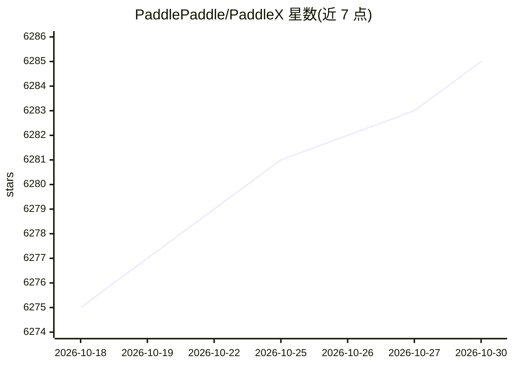

# PaddlePaddle/PaddleX

⭐ 6,285 · Python · Apache-2.0 · 推送 2026-10-20 · [GitHub](https://github.com/PaddlePaddle/PaddleX) · [官网](https://paddlepaddle.github.io/PaddleX/) · 组织维护 · 中文 README

**面向AI开发者的飞桨低代码全流程开发工具，覆盖训练到部署**

基于飞桨框架构建的低代码开发工具，集成200+预训练模型组成33条模型产线（OCR、目标检测、图像分割、时序预测、文档解析等），提供统一命令行与Python API调用，支持二次开发、高性能推理、服务化部署与端侧部署。支持英伟达GPU及昆仑芯、昇腾、寒武纪、海光等国产硬件。安装依赖Python 3.8-3.13与PaddlePaddle 3.0+，通过pip安装，另提供AI Studio星河社区云端图形化开发界面。

## 筛选速览

| 维度 | 判定 | 备注 |
|---|---|---|
| AI 角色 | `ai-ecosystem` | LLM/agent 周边工具 |
| 许可风险 | `permissive` | Apache-2.0 |
| 部署形态 | `library` | 以包/库形式分发 |
| 模型依赖 | — | README 未给出锁定关系 |
| 硬件要求 | — | 无带数字的原话,不猜 |
| 安装摩擦 | `medium` | 含编译或系统依赖之一 |
| 成熟度 | — | 结构信号不足 |

## 能力要点

- 33条模型产线、39种单功能模块，覆盖OCR/检测/分割/时序等场景
- 统一命令行与Python API，支持模型训练到部署全流程
- 支持高性能推理、服务化部署、端侧部署与多卡推理
- 适配英伟达、昆仑芯、昇腾、寒武纪、海光、燧原等多家硬件

## 适用场景

- 用一行命令快速体验OCR、目标检测等预训练模型产线
- 在自有数据上二次开发模型并部署到服务或端侧
- 在国产硬件（昇腾/昆仑芯/寒武纪等）上运行模型产线

## 场景标签

`OCR` `目标检测` `文档解析` `语音识别` · 领域:知识与检索

## 证据(README 行号)

> L9: PaddleX 3.0 是基于飞桨框架构建的低代码开发工具，它集成了众多**开箱即用的预训练模型**，可以实现模型从训练到推理的**全流程开发**，支持国内外**多款主流硬件**，助力AI 开发者进行产业实践。
> L89:  **PaddleX 致力于实现产线级别的模型训练、推理与部署。模型产线是指一系列预定义好的、针对特定AI任务的开发流程，其中包含能够独立完成某类任务的单模型（单功能模块）组合。**
> L93: PaddleX的各个产线均支持本地**快速推理**，部分模型支持在AI Studio星河社区上进行**在线体验**，您可以快速体验各个产线的预训练模型效果，如果您对产线的预训练模型效果满意，可以直接对产线进行高性能推理/服务化部署

## 星数曲线

2026-10-18 6,275 → 2026-10-30 6,285（+10）

---
*卡片 v1 · prompt 1.4 · 生成 2026-10-20 · 置信度 high · 依据 README sha `d881ec171f3d` · [字段定义](../../DATASET.md)*
