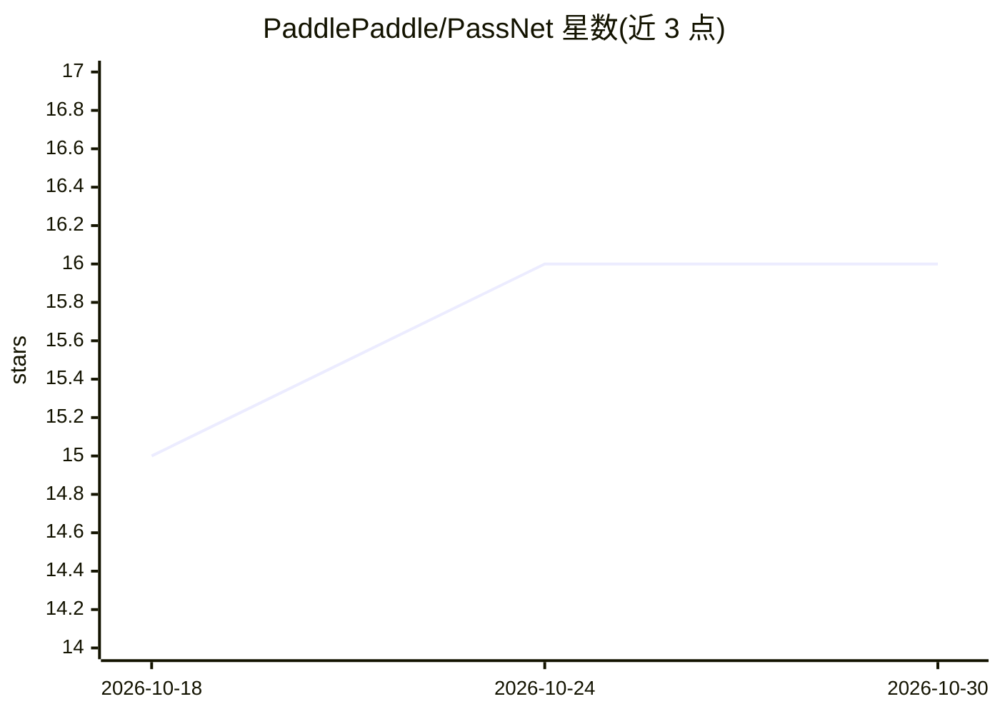

# PaddlePaddle/PassNet

⭐ 16 · 推送 2026-06-01 · [GitHub](https://github.com/PaddlePaddle/PassNet) · 组织维护 · 中文 README

**LLM Agent 自动生成 GPU 编译优化 Pass 的系统与评测基准**

面向编译器优化的 AI 系统：由 LLM 驱动的 PassAgent 生成优化 pass 文件，经 pass_mgr 在 FX 计算图上匹配并替换为优化内核，随后由 PassBench 完成数值正确性验证与性能基准测试（100 次试跑、ES(t) 评分）。附带来自 HuggingFace 模型抽取的计算子图数据集（v2 含 sole op/fusible/typical 三类共约 5.3 万子图），样本内嵌评估框架可在 Docker 容器中独立执行。要求 Python 3.12+、PyTorch 2.9+、NVIDIA GPU（CUDA 12.8）。

## 筛选速览

| 维度 | 判定 | 备注 |
|---|---|---|
| AI 角色 | `ai-native` | 本体是模型或模型工具 |
| 许可风险 | `none` | — |
| 部署形态 | `self-host` | docker 或自建部署 |
| 模型依赖 | — | README 未给出锁定关系 |
| 硬件要求 | — | 无带数字的原话,不猜 |
| 安装摩擦 | `low` | 无编译、无系统依赖或容器化 |
| 成熟度 | — | 结构信号不足 |

## 能力要点

- PassAgent：LLM agent 生成编译优化 pass，pass_mgr 在 FX 图上匹配替换
- PassBench：内核编译、dtype 级正确性验证与性能基准（ES(t) 评分聚合）
- 大规模计算子图数据集（v2：sole op 5,939 / fusible 22,870 / typical 25,151）
- 每个样本含 entry.sh 与评估框架副本，可在 Docker 容器内独立运行

## 适用场景

- 评测编译优化 pass 或 LLM agent 在 GPU kernel 生成任务上的表现
- 基于公开计算子图数据训练或评测编译优化模型
- 在容器化环境中复现 kernel 编译-验证-测速全流程

## 场景标签

`模型评测` `编码 Agent` · 领域:编码与开发

## 证据(README 行号)

> L8: PassNet is an AI system for compiler optimization that leverages LLM-driven agents to automatically generate high-pe
> L173: 2. **Generate optimization pass**: LLM agent generates a pass file and places it in `pass_dir/`

## 星数曲线

2026-10-18 15 → 2026-10-30 16（+1）

---
*卡片 v1 · prompt 1.4 · 生成 2026-10-30 · 置信度 mid · 依据 README sha `0d018fa9fc7e` · [字段定义](../../DATASET.md)*
