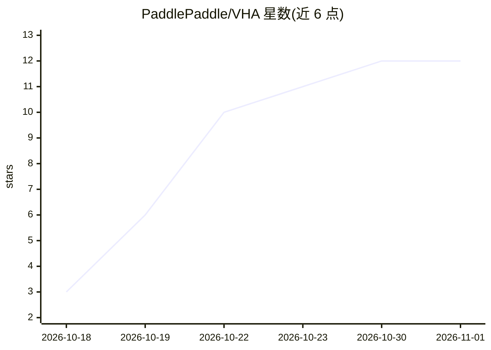

# PaddlePaddle/VHA

⭐ 12 · Python · Apache-2.0 · 推送 2026-10-14 · [GitHub](https://github.com/PaddlePaddle/VHA) · 组织维护

**面向 LLM 的 Virtual Head Attention 官方训练实现**

NeurIPS 2026 论文 Virtual Head Attention 的 PaddleFleet 官方实现。VHA 通过训练期两个操作（Q Premix 将少量物理查询头扩展为组内虚拟头、Linear Postmix 跨组混合注意力输出）在推理时折叠回标准 GQA，无需专用注意力内核，从而降低 KV 缓存与训练/prefill 计算。仓库包含单 GPU GPT 示例与 VHA 路径测试；当前实现要求张量并行度为 1，示例需 Linux x86-64、NVIDIA GPU 与 CUDA 13 兼容驱动，通过 uv 运行。

## 筛选速览

| 维度 | 判定 | 备注 |
|---|---|---|
| AI 角色 | `ai-ecosystem` | LLM/agent 周边工具 |
| 许可风险 | `permissive` | Apache-2.0 |
| 部署形态 | `None` |  |
| 模型依赖 | — | README 未给出锁定关系 |
| 硬件要求 | — | 无带数字的原话,不猜 |
| 安装摩擦 | `medium` | 含编译或系统依赖之一 |
| 成熟度 | — | 结构信号不足 |

## 能力要点

- 训练用虚拟头、推理折叠为标准 GQA-2，无需 VHA 专用注意力内核
- 提供 PaddleFleet 训练实现、可运行的单 GPU GPT 示例与单卡测试
- 论文报告 0.6B–30B 多规模实验，含 8B-A1B MoE 与 128K 长上下文评测

## 适用场景

- 在 PaddleFleet 中训练采用 VHA 注意力的 GPT 类模型
- 复现论文中 VHA 与 GQA/MLA 的对比实验
- 研究注意力头压缩与 KV 缓存权衡的机制

## 场景标签

`模型训练` · 领域:训练与推理

## 证据(README 行号)

> L5: *NeurIPS 2026 · 📄 Paper*
> L11: This repository contains the PaddleFleet training implementation, a runnable single-GPU GPT example, and tests for 

## 星数曲线

2026-10-18 3 → 2026-11-01 12（+9）

---
*卡片 v1 · prompt 1.4 · 生成 2026-11-01 · 置信度 high · 依据 README sha `62b53dd37beb` · [字段定义](../../DATASET.md)*
