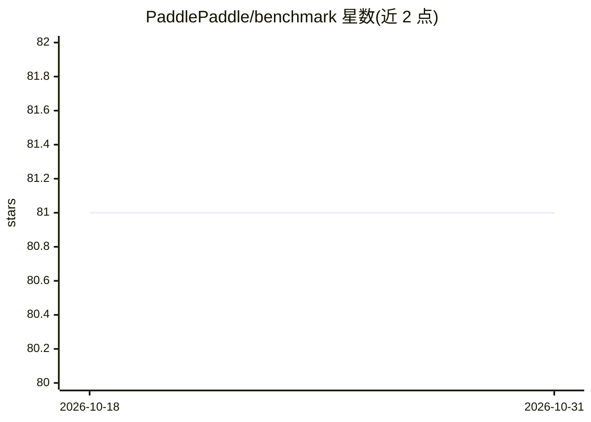

# PaddlePaddle/benchmark

⭐ 81 · Python · 推送 2026-04-07 · [GitHub](https://github.com/PaddlePaddle/benchmark) · 组织维护 · 中文 README

**PaddlePaddle v1.5.0 训练性能与显存占用基准测试报告**

PaddlePaddle 官方基准测试仓库：针对 v1.5.0 版本，在 CV（SE-ResNeXt50、Mask-RCNN、YOLOv3、DeepLab V3+、Cycle-GAN）、NLP（PaddingRNN、BERT、Transformer）与强化学习（DDPG）共 9 个模型上，测量单卡与八卡（单进程/多进程）训练速度和显存占用，并与 TensorFlow、PyTorch、MXNet 对应开源实现逐项列表对比。测试环境为 V100 GPU 服务器（CUDA 9.0/10.0），使用 Paddle 与对比框架的官方 Docker 镜像。结果包含部分 Paddle 慢于 TensorFlow 的项（PaddingRNN static 模式）。

## 筛选速览

| 维度 | 判定 | 备注 |
|---|---|---|
| AI 角色 | `ai-knowledge` | 知识聚合/清单类 |
| 许可风险 | `none` | — |
| 部署形态 | `None` |  |
| 模型依赖 | — | README 未给出锁定关系 |
| 硬件要求 | — | 无带数字的原话,不猜 |
| 安装摩擦 | `medium` | 含编译或系统依赖之一 |
| 成熟度 | — | 结构信号不足 |

## 能力要点

- 覆盖 CV/NLP/强化学习 9 个模型的训练速度与显存数据
- 与 TensorFlow 1.12/1.14、PyTorch 1.1.0、MXNet 的逐项对比表格
- 记录单卡与八卡（单进程/多进程）两种训练方式数据
- 公开测试环境细节（V100-SXM2、CUDA 9.0/10.0、Docker 镜像、commit 哈希）

## 适用场景

- 选型前查询 PaddlePaddle 各模型在 GPU 上的实测训练性能
- 对比 Paddle 与 TensorFlow/PyTorch/MXNet 的吞吐与显存占用
- 复现基准测试时获取环境配置与镜像信息

## 场景标签

 · 领域:深度学习框架/性能评测

## 证据(README 行号)

> L3: 我们对PaddlePaddle的最新版本v1.5.0，在训练性能和显存占用方面进行了基准测试。
> L9:  - 本次测试PaddlePaddle v1.5.0，具体commit是：`401c03fc20478f5cc067440422fc3a7b306d0e32`
> L42: |方向|模型|Paddle|TensorFlow|PyTorch|MXNet|数据集|batch_size(单卡)|

## 星数曲线

2026-10-18 81 → 2026-10-31 81（+0）

---
*卡片 v1 · prompt 1.4 · 生成 2026-10-24 · 置信度 high · 依据 README sha `837c93612e5f` · [字段定义](../../DATASET.md)*
