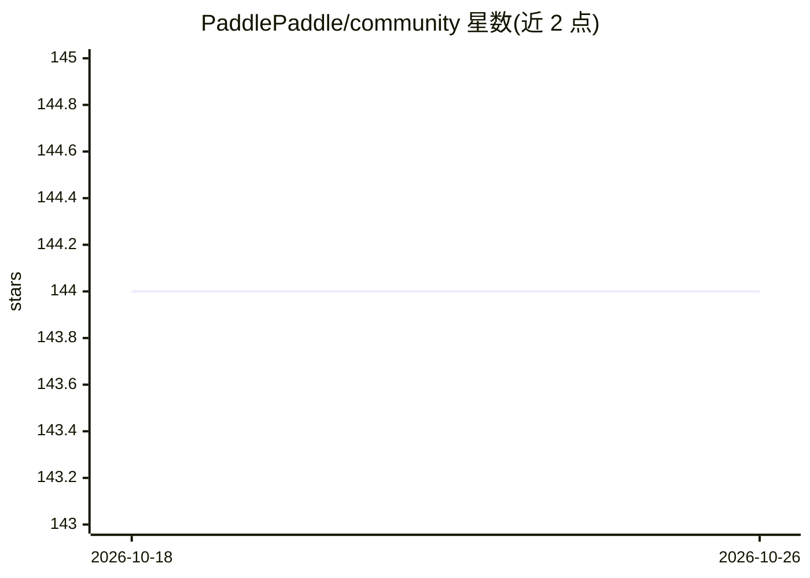

# PaddlePaddle/community

⭐ 144 · Jupyter Notebook · Apache-2.0 · 推送 2026-10-13 · [GitHub](https://github.com/PaddlePaddle/community) · 组织维护 · 中文 README

**PaddlePaddle 框架的开源社区治理与贡献入口**

PaddlePaddle 官方社区仓库，汇集社区活动信息、双周贡献者线上会议、分层技术治理结构（开源开发工作组、框架贡献者俱乐部、多个 SIG 与 Paddle2ONNX PMC）、RFC 提交流程、导师制贡献计划与贡献者认证机制。面向希望参与该深度学习框架文档改进、代码贡献与社区活动的开发者，是加入和了解 PaddlePaddle 社区的起点。

## 筛选速览

| 维度 | 判定 | 备注 |
|---|---|---|
| AI 角色 | `ai-ecosystem` | LLM/agent 周边工具 |
| 许可风险 | `permissive` | Apache-2.0 |
| 部署形态 | `None` |  |
| 模型依赖 | — | README 未给出锁定关系 |
| 硬件要求 | — | 无带数字的原话,不猜 |
| 安装摩擦 | `low` | 无编译、无系统依赖或容器化 |
| 成熟度 | — | 结构信号不足 |

## 能力要点

- 分层技术治理结构：工作组、贡献者俱乐部、SIG 与 PMC
- RFC 流程支持提出新想法
- 带导师制的贡献活动与贡献者认证

## 适用场景

- 了解如何参与 PaddlePaddle 框架的代码与文档贡献
- 申请社区角色与查看治理流程
- 通过导师制计划参与贡献活动

## 场景标签

 · 领域:开源社区/深度学习框架

## 证据(README 行号)

> L1: # PaddlePaddle Community
> L2: Welcome to the PaddlePaddle community! This is the starting point for joining and contributing to the PaddlePaddle c

## 星数曲线

2026-10-18 144 → 2026-10-26 144（+0）

---
*卡片 v1 · prompt 1.4 · 生成 2026-10-22 · 置信度 mid · 依据 README sha `acb3056f5b6b` · [字段定义](../../DATASET.md)*
