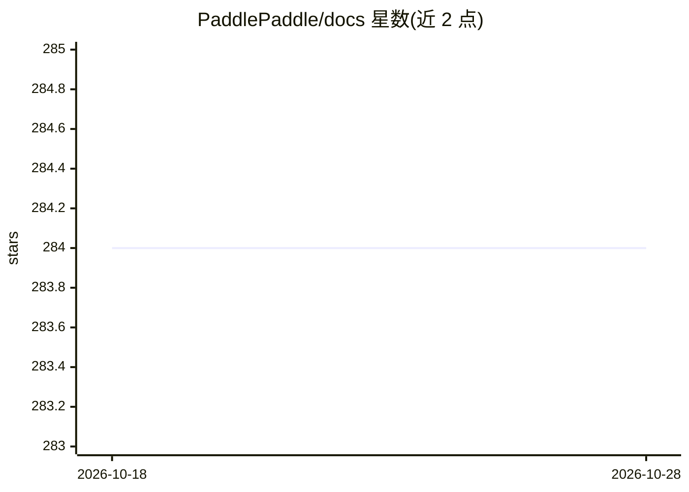

# PaddlePaddle/docs

⭐ 284 · Python · Apache-2.0 · 推送 2026-10-13 · [GitHub](https://github.com/PaddlePaddle/docs) · [官网](https://www.paddlepaddle.org.cn/documentation/docs/zh/guides/index_cn.html) · 组织维护 · 中文 README

**PaddlePaddle 深度学习框架的官方文档源文件仓库**

存放 PaddlePaddle 官方文档站内容的源文件仓库，覆盖 PaddlePaddle 2.0 及以上版本的文档、API 文档、使用指南与教程；英文 API 文档主体为 Paddle 仓库中的 docstring，其他子项目文档由各自仓库管理。构建依赖 Docker：克隆仓库后运行 docs-build.sh 脚本生成 HTML 到 output 目录本地预览；仓库另含文档 CI 脚本并接受社区文档贡献。Apache 2.0 许可。

## 筛选速览

| 维度 | 判定 | 备注 |
|---|---|---|
| AI 角色 | `ai-knowledge` | 知识聚合/清单类 |
| 许可风险 | `permissive` | Apache-2.0 |
| 部署形态 | `None` |  |
| 模型依赖 | — | README 未给出锁定关系 |
| 硬件要求 | — | 无带数字的原话,不猜 |
| 安装摩擦 | `low` | 无编译、无系统依赖或容器化 |
| 成熟度 | — | 结构信号不足 |

## 能力要点

- 覆盖 PaddlePaddle 2.0+ 的文档、API、指南与教程源文件
- 提供基于 Docker 的文档构建脚本与本地预览流程
- 包含文档 CI 脚本，接受社区文档贡献

## 适用场景

- 查阅或本地构建 PaddlePaddle 官方文档
- 为 PaddlePaddle 文档提交修改或翻译
- 了解 PaddlePaddle 文档仓库的组织结构

## 场景标签

 · 领域:深度学习/文档

## 证据(README 行号)

> L5: Source files for contents presented at PaddlePaddle documentation.
> L11: - docs: PaddlePaddle 2.0 & above docs source file.

## 星数曲线

2026-10-18 284 → 2026-10-28 284（+0）

---
*卡片 v1 · prompt 1.4 · 生成 2026-10-22 · 置信度 high · 依据 README sha `2f84b0c6762e` · [字段定义](../../DATASET.md)*
