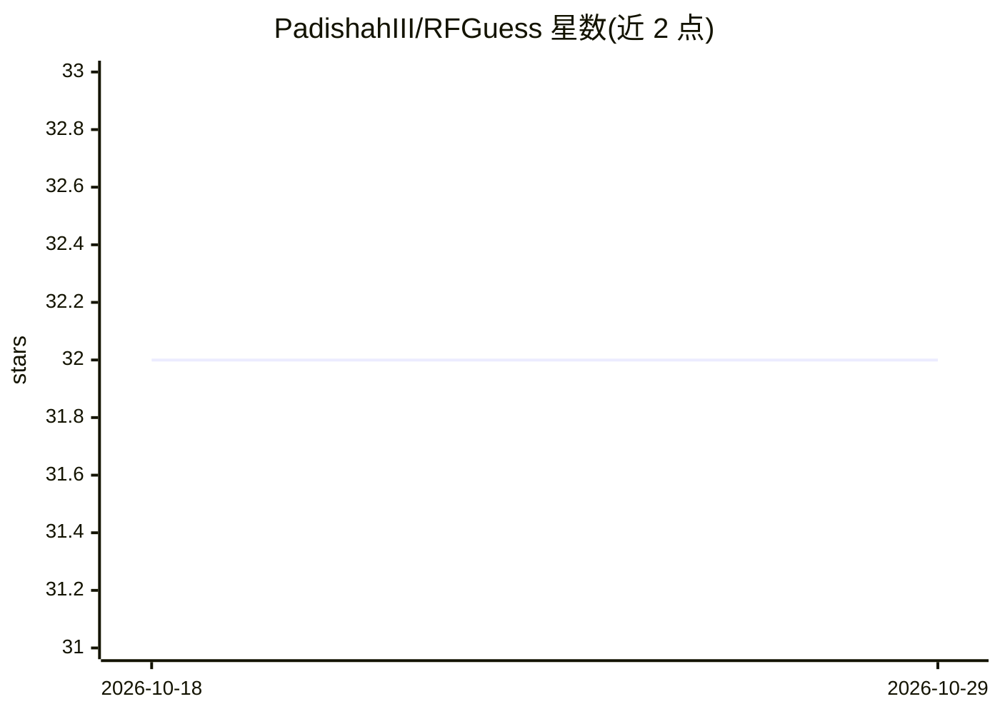

# PadishahIII/RFGuess

⭐ 32 · HTML · MIT · 推送 2026-04-25 · [GitHub](https://github.com/PadishahIII/RFGuess) · [官网](https://www.usenix.org/conference/usenixsecurity23/presentation/wang-ding-password-guessing) · 个人维护 · 中文 README

**基于随机森林的社工密码字典生成工具（GUI）**

复现 USENIX Security 2023 论文《Password Guessing Using Random Forest》的工具：将目标用户的 PII（姓名、生日、手机、邮箱、身份证等）转换为结构表示，训练随机森林分类器生成密码模式，再结合 PII 数据生成针对个人的密码字典。提供 PyQt5 GUI（模式生成、字典生成、模型训练三模块）与预训练模型，支持自建数据集训练与命中率评估（50/50 训练测试划分）。依赖 Python 3.11、MySQL、Sklearn，中间数据结构存于数据库。

## 筛选速览

| 维度 | 判定 | 备注 |
|---|---|---|
| AI 角色 | `ai-native` | 本体是模型或模型工具 |
| 许可风险 | `permissive` | MIT |
| 部署形态 | `self-host` | docker 或自建部署 |
| 模型依赖 | — | README 未给出锁定关系 |
| 硬件要求 | — | 无带数字的原话,不猜 |
| 安装摩擦 | `low` | 无编译、无系统依赖或容器化 |
| 成熟度 | — | 结构信号不足 |

## 能力要点

- PII 驱动的定向密码猜测（Markov n-gram + 随机森林）
- 附 11 万条数据训练的预训练模型
- GUI 覆盖模式生成、字典生成、模型训练与准确率评估
- 支持自定义 PII 数据集（csv 格式，name 与 password 字段必填）

## 适用场景

- 对特定目标的个人信息生成定向密码字典
- 用自己的 PII 数据集训练随机森林猜测模型
- 评估生成的密码字典能否命中真实密码

## 场景标签

`网络安全` · 领域:学习与行业

## 证据(README 行号)

> L4: This repository contains the reproduction for the paper Password Guessing Using Random Forest. The author proposes a
> L5: I have implemented the main concept of the paper and programmed an easy-to-use tool for training models, generating 

## 星数曲线

2026-10-18 32 → 2026-10-29 32（+0）

---
*卡片 v1 · prompt 1.4 · 生成 2026-10-26 · 置信度 high · 依据 README sha `c958d253f566` · [字段定义](../../DATASET.md)*
