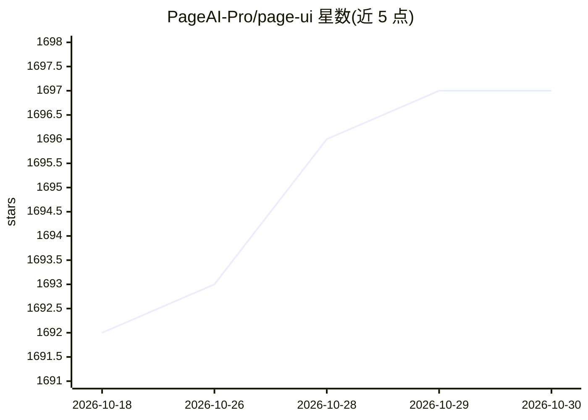

# PageAI-Pro/page-ui

⭐ 1,697 · TypeScript · MIT · 推送 2026-07-06 · [GitHub](https://github.com/PageAI-Pro/page-ui) · [官网](https://pageai.pro) · 组织维护

**React/Next.js 落地页组件与模板库，复制粘贴即用**

面向 React 与 Next.js 开发者的落地页 UI 组件、模板与示例集合，基于 Tailwind CSS 构建，采用复制粘贴到项目中的使用方式（灵感来自 Shadcn UI），支持主题定制。提供 Specta、Gnomie AI 等 4 个落地页模板及组件示例站点。通过 npx @page-ui/wizard CLI 初始化，需自行安装 Tailwind 相关依赖；当前仅支持 Tailwind v3，v4 支持开发中。仓库同时推广姊妹产品 Page AI（提示词生成整站服务）。

## 筛选速览

| 维度 | 判定 | 备注 |
|---|---|---|
| AI 角色 | `ai-enhanced` | 去掉 AI 部分产品仍成立 |
| 许可风险 | `permissive` | MIT |
| 部署形态 | `library` | 以包/库形式分发 |
| 模型依赖 | — | README 未给出锁定关系 |
| 硬件要求 | — | 无带数字的原话,不猜 |
| 安装摩擦 | `low` | 无编译、无系统依赖或容器化 |
| 成熟度 | — | 结构信号不足 |

## 能力要点

- 免费落地页组件与模板集合，Tailwind CSS 主题化
- 提供 @page-ui/wizard CLI 初始化安装
- 附 4 个完整落地页模板与组件演示站
- 当前仅兼容 Tailwind v3（v4 支持开发中）

## 适用场景

- 为 SaaS 或开发者工具产品快速搭建落地页
- 从模板与示例中复制所需组件到 Next.js 项目
- 避开从零设计落地页的初始空白页问题

## 场景标签

 · 领域:前端/Web UI 组件

## 证据(README 行号)

> L10: A collection of **free templates**, components and examples to create beautiful,
> L11: high-converting landing pages with React and Next.js. Open source & themeable

## 星数曲线

2026-10-18 1,692 → 2026-10-30 1,697（+5）

---
*卡片 v1 · prompt 1.4 · 生成 2026-10-21 · 置信度 low · 依据 README sha `9188ef6ef8a7` · [字段定义](../../DATASET.md)*
