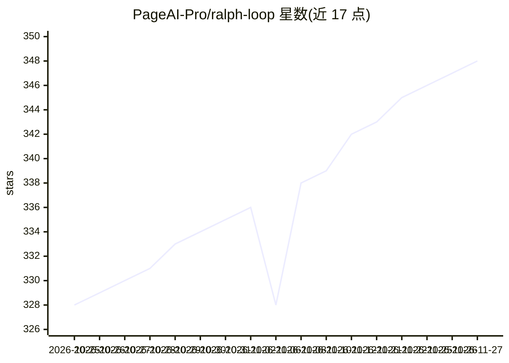

# PageAI-Pro/ralph-loop

⭐ 348 · Shell · MIT · 推送 2026-11-18 · [GitHub](https://github.com/PageAI-Pro/ralph-loop) · [官网](https://ralphloop.sh) · 组织维护

**开发者的长时 AI agent 编码循环：按任务清单迭代至完成**

一个可配置的长时 agent 循环脚本：读取 PRD 生成的任务清单，每轮选一个任务、实现、冒烟测试、运行测试/lint/类型检查并提交，直到任务完成或达到最大轮数；通过 promise 标签与退出码报告 COMPLETE/BLOCKED/DECIDE 状态。默认在 Docker Sandboxes 中运行 Claude Code，支持切换其他 agentic CLI；附带 prd-creator 等 14 个技能与 STEERING.md 中途干预机制。依赖 Node 生态与 Docker，默认面向 React/TypeScript 技术栈。

## 筛选速览

| 维度 | 判定 | 备注 |
|---|---|---|
| AI 角色 | `ai-ecosystem` | LLM/agent 周边工具 |
| 许可风险 | `permissive` | MIT |
| 部署形态 | `library` | 以包/库形式分发 |
| 模型依赖 | — | README 未给出锁定关系 |
| 硬件要求 | — | 无带数字的原话,不猜 |
| 安装摩擦 | `low` | 无编译、无系统依赖或容器化 |
| 成熟度 | `idea` | |

## 能力要点

- 每轮任务自动实现-测试-提交流程，最多可设 50 轮
- 默认在 Docker Sandboxes 中运行 Claude Code，隔离执行
- prd-creator 技能将需求转成 PRD 与任务清单
- STEERING.md 文件支持循环运行中插入优先工作

## 适用场景

- 把需求文档转成任务清单后无人值守地逐步实现
- 让 agent 连续多轮处理带测试的大型功能拆解
- 在沙箱里跑 agent 避免改动本机环境
- 需要 BLOCKED/DECIDE 状态与退出码接入自动化流水线

## 场景标签

`编码 Agent` · 领域:编码与开发

## 证据(README 行号)

> L7: Ralph is a long-running AI agent loop. Ralph automates software development tasks by iteratively working through a t
> L9: This is an implementation that actually works, containing a hackable script so you can configure it to your env and 

## 星数曲线

2026-10-25 328 → 2026-11-27 348（+20）

---
*卡片 v1 · prompt 1.4 · 生成 2026-11-25 · 置信度 mid · 依据 README sha `dec48a573ed0` · [字段定义](../../DATASET.md)*
