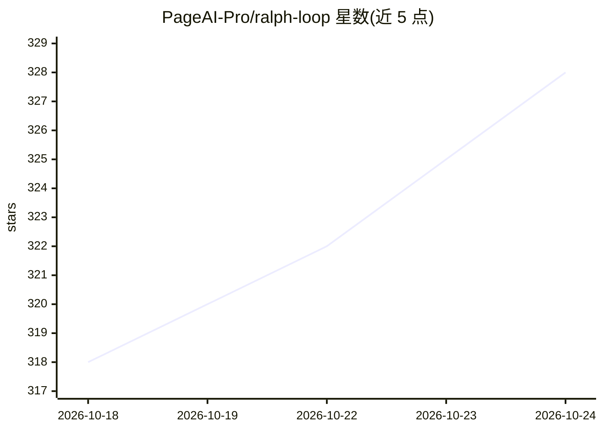

# PageAI-Pro/ralph-loop

⭐ 328 · Shell · MIT · 推送 2026-08-31 · [GitHub](https://github.com/PageAI-Pro/ralph-loop) · [官网](https://ralphloop.sh) · 组织维护

**长时运行的 AI 编码 agent 循环脚本：迭代完成任务列表**

Ralph 是一个可修改的 bash 循环脚本，驱动编码 agent 在 Docker Sandboxes 沙箱中反复迭代：每轮从 .agent/tasks.json 取最高优先级任务，执行任务步骤，运行测试/lint/类型检查，截图并提交，直至任务完成或达到迭代上限。默认使用 Claude Code，可通过 --agent 参数切换 codex/copilot/cursor/gemini/opencode 等 Docker Sandboxes 支持的 agent CLI。附带 prd-creator 技能从需求生成 PRD 与任务表、STEERING.md 运行中干预、promise 语义标签与退出码。默认假设前端技术栈（Playwright/Vitest/TypeScript/ESLint/Prettier），其他栈需自行改 PROMPT.md。

## 筛选速览

| 维度 | 判定 | 备注 |
|---|---|---|
| AI 角色 | `ai-ecosystem` | LLM/agent 周边工具 |
| 许可风险 | `permissive` | MIT |
| 部署形态 | `library` | 以包/库形式分发 |
| 模型依赖 | locked-api |  |
| 硬件要求 | — | 无带数字的原话,不猜 |
| 安装摩擦 | `low` | 无编译、无系统依赖或容器化 |
| 成熟度 | — | 结构信号不足 |

## 能力要点

- 每轮迭代自动取任务、实现、测试、lint、提交的循环机制
- 默认 Claude Code，支持 codex/copilot/cursor/gemini/opencode 六种 agent CLI
- Docker Sandboxes 沙箱隔离运行，确定性命名便于复用
- 运行中可通过 STEERING.md 插入优先任务，含 13 个内置技能

## 适用场景

- 让 AI agent 长时间自动完成拆解好的软件开发任务列表
- 从自然语言需求生成 PRD 与任务表再交给 agent 循环执行
- 在沙箱中无人值守跑迭代开发并保留每轮日志与截图

## 场景标签

`编码 Agent` · 领域:编码与开发

## 证据(README 行号)

> L7: Ralph is a long-running AI agent loop. Ralph automates software development tasks by iteratively working through a t
> L9: This is an implementation that actually works, containing a hackable script so you can configure it to your env and 

## 星数曲线

2026-10-18 318 → 2026-10-24 328（+10）

---
*卡片 v1 · prompt 1.4 · 生成 2026-10-21 · 置信度 mid · 依据 README sha `0098fe469db2` · [字段定义](../../DATASET.md)*
