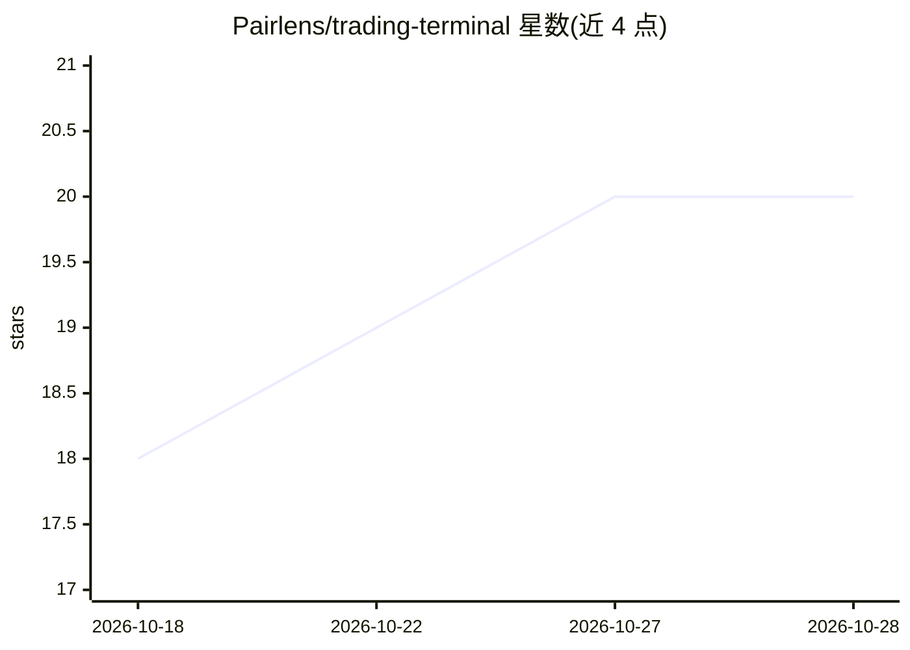

# Pairlens/trading-terminal

⭐ 20 · TypeScript · NOASSERTION · 推送 2026-09-09 · [GitHub](https://github.com/Pairlens/trading-terminal) · [官网](https://pairlens.finance) · 组织维护

**本地优先的多市场加密/美股 AI 交易终端**

面向个人交易者的桌面（Tauri）与浏览器交易终端：聚合 17 个加密现货交易所、永续合约、Alpaca 美股、Kalshi/Polymarket 预测市场、NFT 与多链 DEX，行情经插件直连交易所，API 密钥存于 OS 钥匙串，无中间服务器。内置 AI 助手（113 个工具）可读行情、驱动图表、写 Python 指标并回测、部署机器人；交易须用户确认，风险限制在 AI 之下的层面强制执行。AI 推理走自带 key 的 Groq/OpenAI/DeepSeek/Anthropic/OpenRouter 插件，或订阅托管计划。支持插件 SDK 与自托管插件仓库；源码以 FSL-1.1-Apache-2.0 提供。

## 筛选速览

| 维度 | 判定 | 备注 |
|---|---|---|
| AI 角色 | `ai-enhanced` | 去掉 AI 部分产品仍成立 |
| 许可风险 | `none` | NOASSERTION |
| 部署形态 | `desktop` | 安装包/桌面程序 |
| 模型依赖 | locked-api |  |
| 硬件要求 | — | 无带数字的原话,不猜 |
| 安装摩擦 | `low` | 无编译、无系统依赖或容器化 |
| 成熟度 | — | 结构信号不足 |

## 能力要点

- 14+ 加密交易所、美股、预测市场、NFT、DEX 聚合于单一界面
- AI 助手 113 个工具：图表控制、Python 指标编写与回测、机器人部署、确认制下单
- 密钥仅存本地 OS 钥匙串，行情直连交易所，无中间服务器
- 插件化连接器/AI 提供商/主题，提供 SDK 与自托管插件仓库

## 适用场景

- 在一张桌面同时交易多个加密交易所、美股与预测市场
- 让 AI 助手读取行情、标注指标并生成与回测 Python 策略
- 本地托管密钥、不依赖第三方服务器地进行自动化交易

## 场景标签

`金融量化` · 领域:学习与行业

## 证据(README 行号)

> L20: - **One AI assistant for the whole terminal.** It sits in a dock in the corner, follows you from the chart to the w
> L95: - **AI assistant**: the agentic loop runs entirely client-side in the terminal, mounted above the routed content so

## 星数曲线

2026-10-18 18 → 2026-10-28 20（+2）

---
*卡片 v1 · prompt 1.4 · 生成 2026-10-28 · 置信度 high · 依据 README sha `6ae270740858` · [字段定义](../../DATASET.md)*
