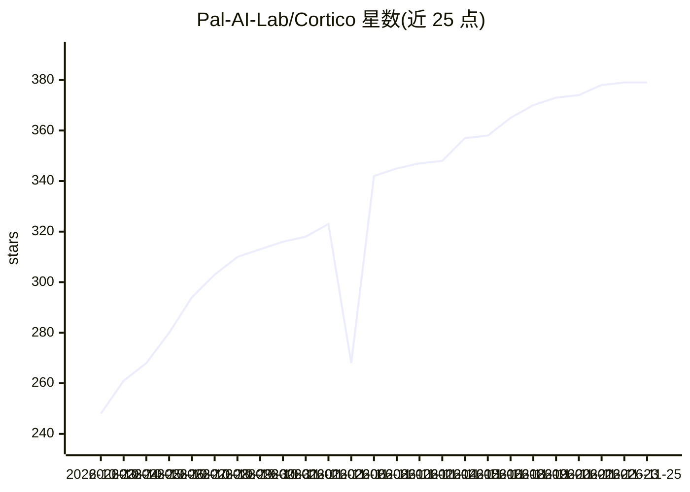

# Pal-AI-Lab/Cortico

⭐ 379 · TypeScript · MIT · 推送 2026-11-24 · [GitHub](https://github.com/Pal-AI-Lab/Cortico) · [官网](https://palailab.org) · 组织维护 · 中文 README

**事件流 AI Agent 框架：构建持续运行的人格化机器人**

围绕事件流设计的 agent harness，面向自主、持续运行且输入来源多样的 agent。四层架构（Core/Persona/Memory/World）分离会话管理、人格语义、状态持久化与外部环境边界；通过 Cortico World 扩展系统接入聊天平台、直播、游戏等环境，内置 Console、QQ、Bilibili 直播、Minecraft、Web Search 等 World。提供 WebUI 管理端点、凭据与运行参数，支持 11 种语言界面。模型侧基于 Responses 协议，可接兼容 API 与本地 llama-server 运行时。需 Node 22+。

## 筛选速览

| 维度 | 判定 | 备注 |
|---|---|---|
| AI 角色 | `ai-ecosystem` | LLM/agent 周边工具 |
| 许可风险 | `permissive` | MIT |
| 部署形态 | `library` | 以包/库形式分发 |
| 模型依赖 | — | README 未给出锁定关系 |
| 硬件要求 | — | 无带数字的原话,不猜 |
| 安装摩擦 | `low` | 无编译、无系统依赖或容器化 |
| 成熟度 | — | 结构信号不足 |

## 能力要点

- 事件流驱动的原生 agent harness，支持多环境并行观察与行动
- 四层架构（Core/Persona/Memory/World）与自由上下文管理
- 扩展系统 Cortico World：事件投递与工具调用为输入输出，可发布到 npm
- Cortina 扩展创建系统：无编程经验者可通过 AI agent 对话构建扩展

## 适用场景

- 搭建驱动 Live2D 模型、流式 TTS 与 OBS 覆盖层的 AI VTuber
- 接入 QQ、Bilibili 直播弹幕等平台的对话机器人
- 让 bot 观察 Minecraft 游戏状态并自主执行动作
- 通过 Cortina 用对话方式为自己定制环境扩展

## 场景标签

`Agent 框架` `聊天机器人` `GUI 自动化` · 领域:Agent 开发

## 证据(README 行号)

> L22: Cortico is an agent harness designed around an event stream, built for autonomous, continuously running agents with
> L29: 2. 🤖 A native agent harness: everything is designed around the agent.
> L96: |**Core**|Manages session lifecycles, event streams, and model invocations. Semantics-free.|`src/core/`|

## 星数曲线

2026-10-23 248 → 2026-11-25 379（+131）

---
*卡片 v1 · prompt 1.4 · 生成 2026-11-25 · 置信度 high · 依据 README sha `27420406bd2d` · [字段定义](../../DATASET.md)*
