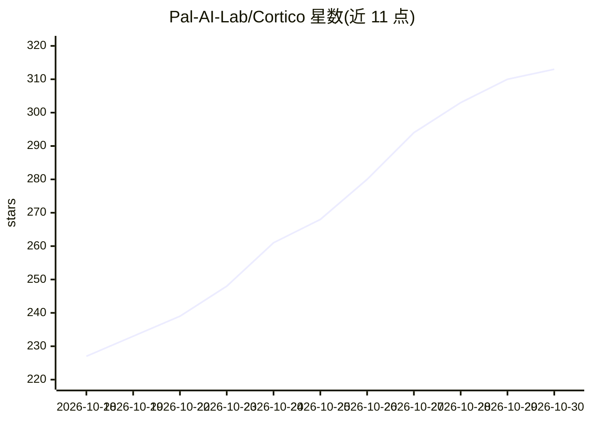

# Pal-AI-Lab/Cortico

⭐ 313 · TypeScript · MIT · 推送 2026-10-29 · [GitHub](https://github.com/Pal-AI-Lab/Cortico) · [官网](https://palailab.org) · 组织维护 · 中文 README

**事件流驱动的自主 persona bot/agent 框架**

TypeScript 编写的 agent harness，以事件流为核心设计，面向持续运行的自主 agent：支持 persona bot、AI 虚拟主播、角色扮演与陪伴等场景。分 Core/Persona/Memory/World 四层架构；模块化 LLM provider（Responses 协议、llama.cpp 本地 llama-server）；扩展系统 Cortico World 可同时接入聊天平台、直播与游戏（内置 QQ、Bilibili 直播、Minecraft、Web 搜索、Console）。附带 WebUI、多语言界面与 AI 辅助开发扩展的 Cortina 工具。需 Node 22+，项目自标 pre-release。

## 筛选速览

| 维度 | 判定 | 备注 |
|---|---|---|
| AI 角色 | `ai-ecosystem` | LLM/agent 周边工具 |
| 许可风险 | `permissive` | MIT |
| 部署形态 | `library` | 以包/库形式分发 |
| 模型依赖 | — | README 未给出锁定关系 |
| 硬件要求 | — | 无带数字的原话,不猜 |
| 安装摩擦 | `low` | 无编译、无系统依赖或容器化 |
| 成熟度 | `idea` | |

## 能力要点

- 事件流架构的四层分离（Core/Persona/Memory/World）
- 支持 Responses 协议 API 与本地 llama.cpp 运行时
- 内置 QQ/Bilibili 直播/Minecraft/Web 搜索等 World 集成
- Cortina：通过对话用 AI agent 构建扩展，无需编程经验

## 适用场景

- 搭建持续在线的 AI VTuber 或 persona bot
- 让一个 bot 同时观察和操作多个环境（聊天、直播、游戏）
- 非开发者用对话方式构建自定义扩展

## 场景标签

`Agent 框架` `聊天机器人` · 领域:Agent 开发

## 证据(README 行号)

> L22: Cortico is an agent harness designed around an event stream, built for autonomous, continuously running agents with
> L30: 3. 🔌 Modular LLM provider components: built on the Responses protocol inside, supporting various upstream LLM APIs 

## 星数曲线

2026-10-18 227 → 2026-10-30 313（+86）

---
*卡片 v1 · prompt 1.4 · 生成 2026-10-22 · 置信度 high · 依据 README sha `1e82ef587a3e` · [字段定义](../../DATASET.md)*
